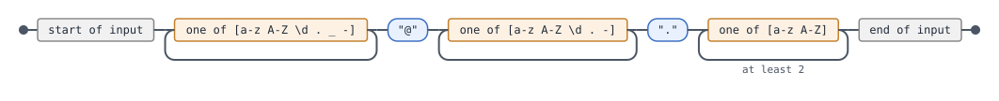
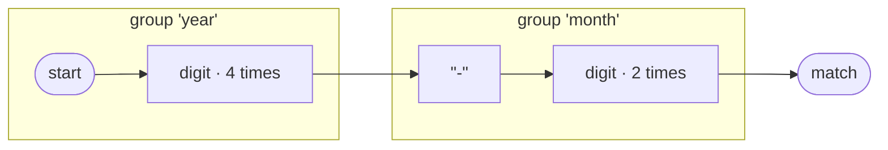

<p align="center">
  <picture>
    <source media="(prefers-color-scheme: dark)" srcset="docs/images/brand/banner-dark.png">
    
  </picture>
</p>

# Masterly.FluentRegex

A fluent, readable API for building regular expression patterns in .NET

[](https://www.nuget.org/packages/Masterly.FluentRegex)    [](https://github.com/a7mdfre7at/Masterly.FluentRegex/actions/workflows/build.yml) [](https://github.com/a7mdfre7at/Masterly.FluentRegex/actions/workflows/codeql-analysis.yml) [](https://github.com/a7mdfre7at/Masterly.FluentRegex/actions/workflows/publish.yml)

## Give a Star! :star:

If you like or are using this project please give it a star. Thanks!

## Table of Contents

- [Introduction](#introduction)
- [Why FluentRegex?](#why-fluentregex)
- [What's New in 3.1](#whats-new-in-31)
- [What's New in 3.0](#whats-new-in-30)
- [Installation](#installation)
- [Quick Start](#quick-start)
- [Core Concepts](#core-concepts)
  - [The Pattern Builder](#the-pattern-builder)
  - [Method Chaining](#method-chaining)
  - [Automatic Escaping](#automatic-escaping)
- [Basic Patterns](#basic-patterns)
  - [Anchors](#anchors)
  - [Character Matchers](#character-matchers)
  - [Literal Text](#literal-text)
  - [Raw Regex](#raw-regex)
- [Character Classes](#character-classes)
  - [Character Sets](#character-sets)
  - [Ranges, Character Lists and Unicode](#ranges-character-lists-and-unicode)
  - [Negated Sets](#negated-sets)
  - [Alternation (OR)](#alternation-or)
  - [Inline Options](#inline-options)
- [Quantifiers (Repeat)](#quantifiers-repeat)
  - [Basic Quantifiers](#basic-quantifiers)
  - [Bounded Quantifiers](#bounded-quantifiers)
  - [Lazy (Non-Greedy) Matching](#lazy-non-greedy-matching)
  - [Possessive Matching](#possessive-matching)
- [Groups](#groups)
  - [Capturing Groups](#capturing-groups)
  - [Named Groups](#named-groups)
  - [Non-Capturing Groups](#non-capturing-groups)
  - [Atomic Groups](#atomic-groups)
  - [Extracting Group Values](#extracting-group-values)
- [Assertions](#assertions)
  - [Lookahead](#lookahead)
  - [Lookbehind](#lookbehind)
  - [Practical Assertion Examples](#practical-assertion-examples)
- [Backreferences](#backreferences)
  - [Named Backreferences](#named-backreferences)
  - [Numbered Backreferences](#numbered-backreferences)
- [Conditional Patterns](#conditional-patterns)
- [Matching API](#matching-api)
  - [Testing Matches](#testing-matches)
  - [Finding Matches](#finding-matches)
  - [Replace Operations](#replace-operations)
  - [Split Operations](#split-operations)
  - [Regex Options](#regex-options)
  - [Timeouts and the Non-Backtracking Engine](#timeouts-and-the-non-backtracking-engine)
  - [Modern .NET APIs](#modern-net-apis)
- [Common Patterns Library](#common-patterns-library)
  - [Contact Information](#contact-information)
  - [Network and System](#network-and-system)
  - [Date and Time](#date-and-time)
  - [Financial and Identity](#financial-and-identity)
  - [User Input](#user-input)
  - [Numbers](#numbers)
  - [Markup](#markup)
  - [More Patterns in 3.0](#more-patterns-in-30)
- [Validation and Debugging](#validation-and-debugging)
  - [Pattern Validation](#pattern-validation)
  - [Group Information](#group-information)
  - [Pattern Explanation](#pattern-explanation)
- [Typed Extraction](#typed-extraction)
- [Fluent Replacements](#fluent-replacements)
- [Regex to Fluent Code](#regex-to-fluent-code)
- [Test Data Generation](#test-data-generation)
- [ReDoS Safety Analysis](#redos-safety-analysis)
- [Match Tracing](#match-tracing)
- [Diagrams](#diagrams)
- [Compile-Time Checks](#compile-time-checks)
  - [Source Generator](#source-generator-generatepattern)
  - [Analyzers](#analyzers)
  - [Code Fix](#code-fix-use-generatedregex)
- [Command-Line Tool](#command-line-tool)
- [Complete Examples](#complete-examples)
  - [Email Validation](#email-validation)
  - [Phone Number Parser](#phone-number-parser)
  - [URL Parser](#url-parser)
  - [Log File Parser](#log-file-parser)
  - [Data Transformation](#data-transformation)
  - [Password Validation](#password-validation)
  - [HTML Tag Extraction](#html-tag-extraction)
  - [CSV Line Parser](#csv-line-parser)
- [API Reference](#api-reference)
  - [Pattern Class](#pattern-class)
  - [Repeat Class](#repeat-class)
  - [CommonPatterns Class](#commonpatterns-class)
- [Best Practices](#best-practices)
- [Performance Considerations](#performance-considerations)
- [Migration Guide](#migration-guide)
  - [Migrating from 2.x to 3.0](#migrating-from-2x-to-30)
- [Contributing](#contributing)
- [License](#license)

---

## Introduction

> Some people, when confronted with a problem, think "I know, I'll use regular expressions." Now they have two problems. *- Jamie Zawinski*

Regular expressions are incredibly powerful, but they're notorious for being difficult to read, write, and maintain. Consider this email validation regex:

```csharp
(?:[a-z0-9!#$%&'*+/=?^_`{|}~-]+(?:\.[a-z0-9!#$%&'*+/=?^_`{|}~-]+)*
  |  "(?:[\x01-\x08\x0b\x0c\x0e-\x1f\x21\x23-\x5b\x5d-\x7f]
      |  \\[\x01-\x09\x0b\x0c\x0e-\x7f])*")
@ (?:(?:[a-z0-9](?:[a-z0-9-]*[a-z0-9])?\.)+[a-z0-9](?:[a-z0-9-]*[a-z0-9])?
  |  \[(?:(?:25[0-5]|2[0-4][0-9]|[01]?[0-9][0-9]?)\.){3}
       (?:25[0-5]|2[0-4][0-9]|[01]?[0-9][0-9]?|[a-z0-9-]*[a-z0-9]:
          (?:[\x01-\x08\x0b\x0c\x0e-\x1f\x21-\x5a\x53-\x7f]
          |  \\[\x01-\x09\x0b\x0c\x0e-\x7f])+)
     \])
```

Can you understand what this does at a glance? Neither can most developers.

**Masterly.FluentRegex** transforms regex creation into readable, maintainable, self-documenting code using a fluent builder pattern.

---

## Why FluentRegex?

### Traditional Regex vs FluentRegex

**Traditional approach:**
```csharp
var regex = new Regex(@"^(?=.*[a-z])(?=.*[A-Z])(?=.*\d)(?=.*[!@#$%^&*]).{8,}$");
```

**FluentRegex approach:**
```csharp
Pattern password = Pattern.With
    .StartOfLine
    .PositiveLookahead(Pattern.With.Anything.Repeat.ZeroOrMore.Set(Pattern.With.LowercaseLetter))
    .PositiveLookahead(Pattern.With.Anything.Repeat.ZeroOrMore.Set(Pattern.With.UppercaseLetter))
    .PositiveLookahead(Pattern.With.Anything.Repeat.ZeroOrMore.Digit)
    .PositiveLookahead(Pattern.With.Anything.Repeat.ZeroOrMore.Set(Pattern.With.Literal("!@#$%^&*")))
    .Anything.Repeat.AtLeast(8)
    .EndOfLine;
```

### Key Benefits

| Feature | Benefit |
|---------|---------|
| **Self-Documenting** | Code reads like English - no regex knowledge needed to understand |
| **IntelliSense Support** | Full IDE autocompletion guides you through available options |
| **Compile-Time Safety** | Catch errors during development, not at runtime |
| **Maintainable** | Easy to modify patterns months later |
| **Testable** | Break complex patterns into smaller, testable pieces |
| **No Escaping Headaches** | Automatic escaping of special characters |

---

## What's New in 3.1

FluentRegex 3.1 can prove things about your patterns, learn them from examples, and take them beyond
.NET into browsers, APIs, tests and logs. Every feature has a detailed guide in [`docs/features`](docs/features).

| Feature | One line | Guide |
|---------|----------|-------|
| Pattern algebra | `Pattern.Compare(a, b)` proves equivalence or returns the shortest counterexample | [algebra](docs/features/algebra.md) |
| Verified optimizer | `Optimize()` rewrites `cat\|car\|cab` to `ca[trb]` and proves nothing changed | [optimizer](docs/features/optimizer.md) |
| Typed templates | `Template.Of<LogLine>("{Date:yyyy-MM-dd} [{Level}] {Message}")` parses and formats | [templates](docs/features/templates.md) |
| Learn from examples | `Pattern.Learn(match, reject)` infers a readable, anchored pattern | [learn](docs/features/learn.md) |
| Regex coverage | `MeasureCoverage(inputs)` shows which branches and limits your tests never hit | [coverage](docs/features/coverage.md) |
| Property testing | `PatternProperty.ForMatching(p, property)` finds and shrinks counterexamples | [property testing](docs/features/property-testing.md) |
| Semantic rules | `CreditCard().Must(Validators.Luhn)` adds checks a regex can't express | [rules and redaction](docs/features/rules-and-redaction.md) |
| PII redaction | `Redactor.For(Email, Phone).Mask(text)` with mask, label, keep-last and email styles | [rules and redaction](docs/features/rules-and-redaction.md) |
| Export | `ToJavaScript()`, JSON Schema and TypeScript output that keeps the .NET meaning | [export](docs/features/export.md) |
| SQL regex dialects | `ToSqlCondition("Email", RegexFlavor.PostgreSql)` for PostgreSQL, MySQL, MariaDB, SQL Server 2025 and SQLite | [sql flavors](docs/features/sql-flavors.md) |
| LIKE with proof | `ToLike(LikeDialect.SqlServer)` compiles to `LIKE` and proves whether it is exact or a superset | [like](docs/features/like.md) |
| Language facts | `GetLanguageFacts()` proves length bounds and the prefix and suffix every match must have | [language facts](docs/features/language-facts.md) |
| Backtracking profiler | `Profile(input)` counts steps per construct and shows a heatmap | [profiler](docs/features/profiler.md) |
| Streaming | `MatchesAsync(stream)` matches multi-GB input in constant memory | [streaming](docs/features/streaming.md) |
| Highlighting | `Highlight(text)` for terminals, HTML pages and readable test assertions | [highlighting](docs/features/highlighting.md) |
| Unicode scripts | `Script(UnicodeScript.Arabic)`, `DigitIn(...)`, `Grapheme`, `IgnoreDiacritics()` | [unicode](docs/features/unicode.md) |
| Digit mode | `CommonPatterns.IPv4(DigitMode.Ascii)` or `pattern.WithAsciiDigits()` makes `\d` mean 0-9 only | [below](#unicode-or-ascii-digits) |
| DataAnnotations | `[MatchesPattern(typeof(Patterns), nameof(Patterns.Sku))]` | [rules and redaction](docs/features/rules-and-redaction.md) |
| ASP.NET Core | Route constraints such as `{id:pattern(sku)}` from a pattern registry | [aspnetcore](docs/features/aspnetcore.md) |
| xUnit | `[MatchingData]` and `[NonMatchingData]` theory data from any pattern | [xunit](docs/features/xunit.md) |
| AI drafting | Describe a pattern in English; the draft is verified locally before you get it | [ai](docs/features/ai.md) |
| EF Core | `Where(u => EF.Functions.Matches(u.Email, Patterns.Email))` runs in the database, with proven index hints and `CHECK` constraints | [entity framework](docs/features/entity-framework.md) |
| Playground | Try every feature in the browser, with shareable links | [playground](playground/README.md) |

### A quick tour

```csharp
// Prove two patterns differ, with the shortest string that shows it
Pattern.Compare(Pattern.FromRegex(@"\d{3}"), Pattern.FromRegex(@"[0-9]{3}"));
// Not equivalent (left is a proper superset of right). Shortest counterexample: "00٠"

// Optimize with proof
Pattern.FromRegex("cat|car|cab").Optimize().Optimized.ToString();   // "ca[trb]"

// String interpolation in reverse
Template<LogLine> log = Template.Of<LogLine>("{Date:yyyy-MM-dd} [{Level}] {User}: {Message}");
LogLine line = log.Parse("2026-11-02 [WARN] ahmad: disk at 91%");

// Learn a pattern from examples
Pattern.Learn(match: new[] { "INV-2024-0001", "INV-2025-0420" },
              reject: new[] { "INV-24-1", "inv-2024-0001" });               // ^INV-\d{4}-\d{4}$

// Find what your tests never exercise
Pattern.FromRegex(@"^(?:Mr|Ms)\.\s\w+$").MeasureCoverage(new[] { "Mr. Smith" });
// Coverage for ^(?:Mr|Ms)\.\s\w+$: 50% (1/2) ... ✗ branch "Ms" was never matched

// Rules a regex can't express
CommonPatterns.CreditCard().Must(Validators.Luhn, "Luhn checksum").IsMatch("4111 1111 1111 1112");  // false

// One rule, every platform
CommonPatterns.ZipCode().ToJavaScript();   // /^\p{Nd}{5}(?:-\p{Nd}{4})?(?=\n?$)/u

// ...including the database, with the exact .NET meaning or a proven LIKE
Pattern invoice = Pattern.FromRegex(@"^INV-[0-9]{4}-[0-9]{4}\z");
invoice.ToSqlCondition("\"Number\"", RegexFlavor.PostgreSql);   // "Number" ~ '\AINV-[0-9]{4}-[0-9]{4}\Z'
invoice.ToLike(LikeDialect.SqlServer).ToSql("[Number]");         // [Number] LIKE 'INV-[0-9][0-9][0-9][0-9]-[0-9][0-9][0-9][0-9]'  (IsExact: true)
invoice.GetLanguageFacts();                                      // length 13..13, prefix "INV-" (exact)

// Arabic with or without harakat
Pattern.With.Literal("محمد").IgnoreDiacritics().IsMatch("مُحَمَّد");   // true
```

### New packages

| Package | Adds |
|---------|------|
| `Masterly.FluentRegex.AspNetCore` | `AddFluentPatterns(...)` and the `pattern(name)` route constraint |
| `Masterly.FluentRegex.Xunit` | `[MatchingData]` and `[NonMatchingData]` for xUnit v3 theories |
| `Masterly.FluentRegex.AI` | `PatternAssistant`, which drafts patterns with Claude and verifies them locally |
| `Masterly.FluentRegex.EntityFrameworkCore` | `UseFluentRegex()`: patterns in LINQ run as the database's own regex, SQL Server gets proven `LIKE`, indexes get proven prefix hints, and `HasPattern` adds `CHECK` constraints |

All four target .NET 8 and .NET 10. The core package has no new dependencies.

---

## What's New in 3.0

FluentRegex 3.0 goes beyond building patterns. It helps you understand, test, secure and ship them.

| Feature | One line |
|---------|----------|
| [Typed extraction](#typed-extraction) | `pattern.Extract<LogEntry>(line)` binds named groups straight onto records |
| [Regex to fluent code](#regex-to-fluent-code) | `Pattern.FromRegex(legacy).ToFluentCode()` turns cryptic regexes into readable C# |
| [Test data generation](#test-data-generation) | `GenerateMatching()` and `GenerateNonMatching()` produce verified samples and near misses |
| [ReDoS safety analysis](#redos-safety-analysis) | `AnalyzeSafety(confirm: true)` finds catastrophic backtracking and proves it with a timed attack |
| [Match tracing](#match-tracing) | `Trace(input)` shows which construct matched which text, or exactly where matching failed |
| [Diagrams](#diagrams) | `ToRailroadSvg()` and `ToMermaid()` for docs and pull requests |
| [Compile-time checks](#compile-time-checks) | A source generator and analyzers catch invalid patterns, ReDoS and group typos while you type |
| [Command-line tool](#command-line-tool) | `fluentregex scan src` finds risky regexes across a codebase and fails CI on them |
| [Fluent replacements](#fluent-replacements) | `Replace(input, r => r.Group("day").Literal("/").Group("month"))` with validated group names |
| [Immutable patterns](#migrating-from-2x-to-30) | Every call returns a new pattern, so building blocks are safe to share |
| [Modern .NET](#modern-net-apis) | Span APIs, `Count`, timeouts, the non-backtracking engine, and Native AOT support |

---

## Installation

### Package Manager Console
```
Install-Package Masterly.FluentRegex
```

### .NET CLI
```bash
dotnet add package Masterly.FluentRegex
```

### PackageReference
```xml
<PackageReference Include="Masterly.FluentRegex" Version="3.1.0" />
```

The package includes the source generator and analyzers. No extra install is needed for compile-time checks.

### Command-Line Tool (optional)
```bash
dotnet tool install --global Masterly.FluentRegex.Tool
```

### Supported Frameworks

| Target | What you get |
|--------|--------------|
| .NET 10 | Everything, including `EnumerateSplits`; trimming and Native AOT compatible |
| .NET 8 | Everything except `EnumerateSplits`; trimming and Native AOT compatible |
| .NET 9 | The .NET 8 build (.NET 9 left support in May 2026) |
| .NET Standard 2.1 (.NET Core 3.0+, .NET 5-7, Mono, Unity) | The full builder, analysis, generation, tracing and diagrams; no span APIs |

---

## Quick Start

```csharp
using Masterly.FluentRegex;

// Build a pattern
Pattern pattern = Pattern.With
    .StartOfLine
    .Digit.Repeat.OneOrMore
    .Literal("-")
    .Word.Repeat.Times(3, 5)
    .EndOfLine;

// Use it directly - no need to convert to Regex first!
bool isMatch = pattern.IsMatch("123-abc");     // true
bool noMatch = pattern.IsMatch("abc-123");     // false

// Find matches
Match match = pattern.Match("123-test");
MatchCollection matches = pattern.Matches("123-abc 456-def");

// Replace content
string result = pattern.Replace("123-abc", "REPLACED");

// Get the underlying regex string
string regexString = pattern.ToString();  // ^\d+-\w{3,5}$

// Or convert to System.Text.RegularExpressions.Regex
Regex regex = pattern.ToRegex(RegexOptions.IgnoreCase);
```

---

## Core Concepts

### The Pattern Builder

Every pattern starts with `Pattern.With`, which creates a new pattern builder instance:

```csharp
Pattern pattern = Pattern.With
    .Digit
    .Literal("@")
    .Word;
// Result: \d@\w
```

### Method Chaining

FluentRegex uses the builder pattern, where each method returns a `Pattern` instance, enabling elegant method chaining:

```csharp
Pattern email = Pattern.With
    .StartOfLine                                              // ^
    .Set(Pattern.With.Letter.Digit.Literal("._-"))           // [a-zA-Z\d._-]
    .Repeat.OneOrMore                                         // +
    .Literal("@")                                             // @
    .Set(Pattern.With.Letter.Digit.Literal(".-"))            // [a-zA-Z\d.-]
    .Repeat.OneOrMore                                         // +
    .Literal(".")                                             // \.
    .Letter.Repeat.AtLeast(2)                                // [a-zA-Z]{2,}
    .EndOfLine;                                               // $
```

### Automatic Escaping

The `Literal()` method automatically escapes regex special characters:

```csharp
Pattern p1 = Pattern.With.Literal("$100.00");
// Result: \$100\.00  ($ and . are escaped)

Pattern p2 = Pattern.With.Literal("[test]");
// Result: \[test\]   (brackets are escaped)

Pattern p3 = Pattern.With.Literal("a+b*c?");
// Result: a\+b\*c\?  (quantifiers are escaped)
```

Use `RegEx()` when you need raw, unescaped regex:

```csharp
Pattern raw = Pattern.With.RegEx("[a-z]+");
// Result: [a-z]+  (no escaping)
```

---

## Basic Patterns

### Anchors

Anchors match positions, not characters:

| Method | Regex | Description |
|--------|-------|-------------|
| `.StartOfLine` | `^` | Start of line or string |
| `.EndOfLine` | `$` | End of line or string |
| `.WordBoundary` | `\b` | Position between word and non-word character |

```csharp
// Match lines that start with "Error"
Pattern errorLine = Pattern.With
    .StartOfLine
    .Literal("Error");
// Result: ^Error

// Match complete words only
Pattern wholeWord = Pattern.With
    .WordBoundary
    .Literal("test")
    .WordBoundary;
// Result: \btest\b

wholeWord.IsMatch("this is a test");     // true
wholeWord.IsMatch("testing");            // false (not a whole word)
```

### Character Matchers

Single character matchers:

| Method | Regex | Description |
|--------|-------|-------------|
| `.Digit` | `\d` | Any digit [0-9] |
| `.NonDigit` | `\D` | Any non-digit |
| `.Word` | `\w` | Word character [a-zA-Z0-9_] |
| `.NonWord` | `\W` | Non-word character |
| `.Whitespace` | `\s` | Whitespace (space, tab, newline, etc.) |
| `.NonWhitespace` | `\S` | Non-whitespace |
| `.Letter` | `a-zA-Z` | Any letter (use in character sets) |
| `.LowercaseLetter` | `a-z` | Lowercase letter |
| `.UppercaseLetter` | `A-Z` | Uppercase letter |
| `.Anything` | `.` | Any character except newline |
| `.Tab` | `\t` | Tab character |
| `.Newline` | `\n` | Newline character |
| `.CarriageReturn` | `\r` | Carriage return |

```csharp
// Match a word followed by digits
Pattern wordDigits = Pattern.With
    .Word.Repeat.OneOrMore
    .Whitespace
    .Digit.Repeat.OneOrMore;
// Result: \w+\s\d+

wordDigits.IsMatch("item 123");   // true
wordDigits.IsMatch("item123");    // false (no whitespace)
```

### Literal Text

Match exact text with automatic escaping:

```csharp
// Single characters
Pattern p1 = Pattern.With.Literal('$');
// Result: \$

// Multiple characters
Pattern p2 = Pattern.With.Literal('a', 'b', 'c');
// Result: abc

// Strings
Pattern p3 = Pattern.With.Literal("Hello, World!");
// Result: Hello, World!

// Special characters are auto-escaped
Pattern p4 = Pattern.With.Literal("(test)");
// Result: \(test\)
```

### Raw Regex

When you need unescaped regex syntax:

```csharp
// Insert raw regex
Pattern raw = Pattern.With
    .StartOfLine
    .RegEx("[a-z]+")
    .RegEx("\\d{3}")
    .EndOfLine;
// Result: ^[a-z]+\d{3}$
```

---

## Character Classes

### Character Sets

Match one character from a set:

```csharp
// Match any vowel
Pattern vowels = Pattern.With.Set(Pattern.With.Literal("aeiouAEIOU"));
// Result: [aeiouAEIOU]

// Match hex digit (ranges use Range; Literal is always literal, even inside a set)
Pattern hex = Pattern.With.Set(Pattern.With.Digit.Range('a', 'f').Range('A', 'F'));
// Result: [\da-fA-F]
// Shortcut: Pattern.With.HexDigit renders [0-9a-fA-F]

// Match alphanumeric
Pattern alphanumeric = Pattern.With.Set(Pattern.With.Letter.Digit);
// Result: [a-zA-Z\d]

// Combined sets
Pattern identifier = Pattern.With
    .Set(Pattern.With.Letter.Literal("_"))
    .Set(Pattern.With.Letter.Digit.Literal("_")).Repeat.ZeroOrMore;
// Result: [a-zA-Z_][a-zA-Z\d_]*
```

### Ranges, Character Lists and Unicode

```csharp
Pattern.With.Range('a', 'f');                      // [a-f]  (a-f inside a Set)
Pattern.With.AnyOf("+-*/");                        // [\+\-\*/]  every character literal
Pattern.With.NoneOf("\"'");                        // [^"']
Pattern.With.Letter;                               // [a-zA-Z]  (a-zA-Z inside a Set)
Pattern.With.Unicode(UnicodeGroup.Letter);         // \p{L}   any letter in any script
Pattern.With.Unicode(UnicodeCategory.UppercaseLetter); // \p{Lu}
Pattern.With.NotUnicode(UnicodeGroup.Number);      // \P{N}
Pattern.With.UnicodeBlock("Greek");                // \p{IsGreek}
```

`Literal` escapes every special character in context. Inside a `Set` that includes `-`, so
`Set(Literal("a-z"))` matches the three characters `a`, `-` and `z`. Use `Range('a', 'z')` for a range.

### Negated Sets

Match any character NOT in the set:

```csharp
// Match any non-digit
Pattern nonDigit = Pattern.With.NegatedSet(Pattern.With.Digit);
// Result: [^\d]

// Match any character except vowels
Pattern consonants = Pattern.With.NegatedSet(Pattern.With.Literal("aeiouAEIOU"));
// Result: [^aeiouAEIOU]

// Match non-whitespace, non-punctuation
Pattern simple = Pattern.With.NegatedSet(Pattern.With.Whitespace.Literal(".,!?"));
// Result: [^\s\.,!\?]
```

### Alternation (OR)

Match one of several alternatives:

```csharp
// Match yes, no, or maybe
Pattern response = Pattern.With.Choice(
    Pattern.With.Literal("yes"),
    Pattern.With.Literal("no"),
    Pattern.With.Literal("maybe")
);
// Result: (yes|no|maybe)

// Match different file extensions
Pattern imageFile = Pattern.With
    .Word.Repeat.OneOrMore
    .Literal(".")
    .Choice(
        Pattern.With.Literal("jpg"),
        Pattern.With.Literal("png"),
        Pattern.With.Literal("gif"),
        Pattern.With.Literal("webp")
    );
// Result: \w+\.(jpg|png|gif|webp)

// Match different date separators
Pattern dateSeparator = Pattern.With.Choice(
    Pattern.With.Literal("-"),
    Pattern.With.Literal("/"),
    Pattern.With.Literal(".")
);
// Result: (-|/|\.)
```

`Choice` creates a numbered capturing group. When you only need alternation, use `OneOf` or the
`|` operator, which create a non-capturing group and leave group numbers untouched:

```csharp
Pattern.With.OneOf(Pattern.With.Literal("cat"), Pattern.With.Literal("dog"));  // (?:cat|dog)
Pattern.With.OneOf("jpg", "png", "gif");                                        // (?:jpg|png|gif)

Pattern animal = Pattern.With.Literal("cat") | Pattern.With.Literal("dog") | Pattern.With.Literal("bird");
// Result: (?:cat|dog|bird)   chains flatten into one group

Pattern area = Pattern.With.Digit.Repeat.Times(3);
Pattern phone = area + Pattern.With.Literal("-") + area;
// Result: \d{3}-\d{3}   + concatenates patterns
```

### Inline Options

```csharp
Pattern.With.Literal("id:").IgnoreCase(Pattern.With.Literal("abc"));    // id:(?i:abc)
Pattern.With.CaseSensitive(Pattern.With.Literal("X"));                   // (?-i:X)
Pattern.With.InlineOptions(RegexOptions.Singleline, Pattern.With.Anything.Repeat.ZeroOrMore); // (?s:.*)
```

---

## Quantifiers (Repeat)

### Basic Quantifiers

| Method | Regex | Description |
|--------|-------|-------------|
| `.Repeat.OneOrMore` | `+` | One or more times |
| `.Repeat.ZeroOrMore` | `*` | Zero or more times |
| `.Repeat.Optional` | `?` | Zero or one time (optional) |

```csharp
// Required digits
Pattern required = Pattern.With.Digit.Repeat.OneOrMore;
// Result: \d+

// Optional prefix
Pattern optionalPlus = Pattern.With.Literal("+").Repeat.Optional.Digit.Repeat.OneOrMore;
// Result: \+?\d+

// Zero or more spaces
Pattern flexibleSpaces = Pattern.With.Whitespace.Repeat.ZeroOrMore;
// Result: \s*
```

### Bounded Quantifiers

| Method | Regex | Description |
|--------|-------|-------------|
| `.Repeat.Times(n)` | `{n}` | Exactly n times |
| `.Repeat.Times(min, max)` | `{min,max}` | Between min and max times |
| `.Repeat.AtLeast(n)` | `{n,}` | At least n times |
| `.Repeat.AtMost(n)` | `{0,n}` | At most n times |

```csharp
// Phone number: exactly 10 digits
Pattern phone = Pattern.With.Digit.Repeat.Times(10);
// Result: \d{10}

// ZIP code: 5 or 9 digits
Pattern zip = Pattern.With
    .Digit.Repeat.Times(5)
    .Group(Pattern.With.Literal("-").Digit.Repeat.Times(4)).Repeat.Optional;
// Result: \d{5}(-\d{4})?

// Password: 8-20 characters
Pattern password = Pattern.With.Word.Repeat.Times(8, 20);
// Result: \w{8,20}

// At least 3 words
Pattern sentence = Pattern.With
    .Word.Repeat.OneOrMore
    .NonCapturingGroup(Pattern.With.Whitespace.Repeat.OneOrMore.Word.Repeat.OneOrMore)
    .Repeat.AtLeast(2);
// Result: \w+(?:\s+\w+){2,}
```

### Lazy (Non-Greedy) Matching

By default, quantifiers are greedy (match as much as possible). Use `.Lazy` for non-greedy matching:

```csharp
// Greedy: matches entire string between first < and last >
Pattern greedy = Pattern.With.Literal("<").Anything.Repeat.OneOrMore.Literal(">");
// Result: <.+>
// Input: "<a>text<b>" matches "<a>text<b>"

// Lazy: matches smallest possible string
Pattern lazy = Pattern.With.Literal("<").Anything.Repeat.OneOrMore.Lazy.Literal(">");
// Result: <.+?>
// Input: "<a>text<b>" matches "<a>" and "<b>" separately

// Lazy zero or more
Pattern lazyZeroOrMore = Pattern.With.Anything.Repeat.ZeroOrMore.Lazy;
// Result: .*?

// Lazy with quantifiers
Pattern lazyBounded = Pattern.With.Digit.Repeat.Times(1, 5).Lazy;
// Result: \d{1,5}?
```

### Possessive Matching

`.Possessive` makes a quantifier keep everything it matched and never backtrack into it.
It is the simplest cure for catastrophic backtracking. .NET has no possessive syntax, so the
exact equivalent atomic group is emitted:

```csharp
Pattern possessive = Pattern.With.Digit.Repeat.OneOrMore.Possessive;
// Result: (?>\d+)
```

---

## Groups

### Capturing Groups

Capture matched content for extraction or backreference:

```csharp
// Simple capturing group
Pattern grouped = Pattern.With
    .Group(Pattern.With.Digit.Repeat.OneOrMore)
    .Literal("-")
    .Group(Pattern.With.Word.Repeat.OneOrMore);
// Result: (\d+)-(\w+)

Match match = grouped.Match("123-abc");
Console.WriteLine(match.Groups[1].Value);  // "123"
Console.WriteLine(match.Groups[2].Value);  // "abc"
```

### Named Groups

Use meaningful names instead of numbers:

```csharp
// Named capturing groups
Pattern phone = Pattern.With
    .NamedGroup("area", Pattern.With.Digit.Repeat.Times(3))
    .Literal("-")
    .NamedGroup("exchange", Pattern.With.Digit.Repeat.Times(3))
    .Literal("-")
    .NamedGroup("number", Pattern.With.Digit.Repeat.Times(4));
// Result: (?<area>\d{3})-(?<exchange>\d{3})-(?<number>\d{4})

Match match = phone.Match("555-123-4567");
Console.WriteLine(match.Groups["area"].Value);      // "555"
Console.WriteLine(match.Groups["exchange"].Value);  // "123"
Console.WriteLine(match.Groups["number"].Value);    // "4567"
```

### Non-Capturing Groups

Group patterns without creating a capture:

```csharp
// Non-capturing group for repetition
Pattern words = Pattern.With
    .NonCapturingGroup(Pattern.With.Word.Repeat.OneOrMore.Whitespace).Repeat.OneOrMore
    .Word.Repeat.OneOrMore;
// Result: (?:\w+\s)+\w+

// Doesn't pollute match.Groups
Pattern protocol = Pattern.With
    .NonCapturingGroup(Pattern.With.Choice(
        Pattern.With.Literal("http"),
        Pattern.With.Literal("https")
    ))
    .Literal("://");
// Result: (?:http|https)://
```

### Atomic Groups

Prevent backtracking for better performance:

```csharp
// Atomic group - once matched, won't backtrack
Pattern atomic = Pattern.With
    .AtomicGroup(Pattern.With.Digit.Repeat.OneOrMore)
    .Word;
// Result: (?>\d+)\w

// Useful for avoiding catastrophic backtracking
Pattern optimized = Pattern.With
    .AtomicGroup(Pattern.With.Word.Repeat.OneOrMore);
// Result: (?>\w+)
```

### Extracting Group Values

```csharp
Pattern datePattern = Pattern.With
    .NamedGroup("year", Pattern.With.Digit.Repeat.Times(4))
    .Literal("-")
    .NamedGroup("month", Pattern.With.Digit.Repeat.Times(2))
    .Literal("-")
    .NamedGroup("day", Pattern.With.Digit.Repeat.Times(2));

// Single match
Match match = datePattern.Match("Date: 2024-01-15");
if (match.Success)
{
    Console.WriteLine($"Year: {match.Groups["year"].Value}");
    Console.WriteLine($"Month: {match.Groups["month"].Value}");
    Console.WriteLine($"Day: {match.Groups["day"].Value}");
}

// Multiple matches
MatchCollection matches = datePattern.Matches("Events: 2024-01-15, 2024-02-20, 2024-03-25");
foreach (Match m in matches)
{
    Console.WriteLine($"{m.Groups["year"].Value}/{m.Groups["month"].Value}/{m.Groups["day"].Value}");
}
// Output: 2024/01/15, 2024/02/20, 2024/03/25
```

---

## Assertions

Zero-width assertions match positions without consuming characters.

### Lookahead

| Method | Regex | Description |
|--------|-------|-------------|
| `.PositiveLookahead(pattern)` | `(?=...)` | Must be followed by pattern |
| `.NegativeLookahead(pattern)` | `(?!...)` | Must NOT be followed by pattern |

```csharp
// Match 'q' only if followed by 'u'
Pattern qWithU = Pattern.With
    .Literal("q")
    .PositiveLookahead(Pattern.With.Literal("u"));
// Result: q(?=u)

qWithU.IsMatch("queen");  // true (matches 'q')
qWithU.IsMatch("iraq");   // false

// Match 'q' only if NOT followed by 'u'
Pattern qWithoutU = Pattern.With
    .Literal("q")
    .NegativeLookahead(Pattern.With.Literal("u"));
// Result: q(?!u)

qWithoutU.IsMatch("iraq");   // true
qWithoutU.IsMatch("queen");  // false
```

### Lookbehind

| Method | Regex | Description |
|--------|-------|-------------|
| `.PositiveLookbehind(pattern)` | `(?<=...)` | Must be preceded by pattern |
| `.NegativeLookbehind(pattern)` | `(?<!...)` | Must NOT be preceded by pattern |

```csharp
// Match digits preceded by '$'
Pattern price = Pattern.With
    .PositiveLookbehind(Pattern.With.Literal("$"))
    .Digit.Repeat.OneOrMore;
// Result: (?<=\$)\d+

Match match = price.Match("Price: $100");
Console.WriteLine(match.Value);  // "100" (not "$100")

// Match digits NOT preceded by '$'
Pattern nonPrice = Pattern.With
    .NegativeLookbehind(Pattern.With.Literal("$"))
    .Digit.Repeat.OneOrMore;
// Result: (?<!\$)\d+

nonPrice.IsMatch("$100");     // false
nonPrice.IsMatch("Item 100"); // true
```

### Practical Assertion Examples

```csharp
// Password must contain lowercase, uppercase, digit, and be 8+ chars
Pattern strongPassword = Pattern.With
    .StartOfLine
    .PositiveLookahead(Pattern.With.Anything.Repeat.ZeroOrMore.Set(Pattern.With.LowercaseLetter))
    .PositiveLookahead(Pattern.With.Anything.Repeat.ZeroOrMore.Set(Pattern.With.UppercaseLetter))
    .PositiveLookahead(Pattern.With.Anything.Repeat.ZeroOrMore.Digit)
    .Anything.Repeat.AtLeast(8)
    .EndOfLine;

strongPassword.IsMatch("Password1");    // true
strongPassword.IsMatch("password1");    // false (no uppercase)
strongPassword.IsMatch("PASSWORD1");    // false (no lowercase)
strongPassword.IsMatch("Password");     // false (no digit)
strongPassword.IsMatch("Pass1");        // false (less than 8 chars)

// Match word only if it's not part of a longer word
Pattern isolatedNumber = Pattern.With
    .NegativeLookbehind(Pattern.With.Digit)
    .Digit.Repeat.Times(3)
    .NegativeLookahead(Pattern.With.Digit);

isolatedNumber.IsMatch("123");      // true
isolatedNumber.IsMatch("1234");     // false
isolatedNumber.IsMatch("a123b");    // true (letters don't count)
```

---

## Backreferences

Reference previously captured groups within the same pattern.

### Named Backreferences

```csharp
// Find duplicate words
Pattern duplicateWords = Pattern.With
    .WordBoundary
    .NamedGroup("word", Pattern.With.Word.Repeat.OneOrMore)
    .Whitespace.Repeat.OneOrMore
    .Backreference("word")
    .WordBoundary;
// Result: \b(?<word>\w+)\s+\k<word>\b

duplicateWords.IsMatch("the the");        // true
duplicateWords.IsMatch("hello hello");    // true
duplicateWords.IsMatch("hello world");    // false

// Find matching quotes
Pattern quotedString = Pattern.With
    .NamedGroup("quote", Pattern.With.Set(Pattern.With.Literal("'\"")))
    .NegatedSet(Pattern.With.Literal("'\"")).Repeat.ZeroOrMore
    .Backreference("quote");
// Result: (?<quote>['"])[^'"]*\k<quote>

quotedString.IsMatch("'hello'");     // true
quotedString.IsMatch("\"world\"");   // true
quotedString.IsMatch("'mixed\"");    // false
```

### Numbered Backreferences

```csharp
// Reference groups by number (1-based)
Pattern htmlTag = Pattern.With
    .Literal("<")
    .Group(Pattern.With.Word.Repeat.OneOrMore)
    .Literal(">")
    .Anything.Repeat.ZeroOrMore.Lazy
    .Literal("</")
    .Backreference(1)
    .Literal(">");
// Result: <(\w+)>.*?</\1>

htmlTag.IsMatch("<div>content</div>");  // true
htmlTag.IsMatch("<div>content</span>"); // false (mismatched tags)
```

---

## Conditional Patterns

Match different patterns based on whether a group was captured.

```csharp
// Match optional opening paren with required closing paren only if opening exists
Pattern conditional = Pattern.With
    .Group(Pattern.With.Literal("(")).Repeat.Optional
    .Word.Repeat.OneOrMore
    .Conditional(1, Pattern.With.Literal(")"), Pattern.With.RegEx(""));
// Result: (\()?\\w+(?(1)\)|)

conditional.IsMatch("(test)");  // true
conditional.IsMatch("test");    // true
conditional.IsMatch("(test");   // false (opening without closing)
conditional.IsMatch("test)");   // false (closing without opening)

// Named conditional
Pattern namedConditional = Pattern.With
    .NamedGroup("open", Pattern.With.Literal("[")).Repeat.Optional
    .Digit.Repeat.OneOrMore
    .Conditional("open", Pattern.With.Literal("]"), Pattern.With.RegEx(""));
// Result: (?<open>\[)?\d+(?(open)\]|)
```

---

## Matching API

Execute patterns directly without converting to `Regex`.

### Testing Matches

```csharp
Pattern digits = Pattern.With.Digit.Repeat.OneOrMore;

// Basic test
bool hasDigits = digits.IsMatch("abc123def");  // true
bool noDigits = digits.IsMatch("no numbers");  // false

// With options
Pattern caseInsensitive = Pattern.With.Literal("hello");
caseInsensitive.IsMatch("HELLO", RegexOptions.IgnoreCase);  // true
```

### Finding Matches

```csharp
Pattern digits = Pattern.With.Digit.Repeat.OneOrMore;

// First match
Match first = digits.Match("abc123def456");
Console.WriteLine(first.Value);  // "123"
Console.WriteLine(first.Index);  // 3

// First match starting at position
Match fromPos = digits.Match("abc123def456", 5);
Console.WriteLine(fromPos.Value);  // "456"

// All matches
MatchCollection all = digits.Matches("a1b22c333d4444");
foreach (Match m in all)
{
    Console.WriteLine($"'{m.Value}' at index {m.Index}");
}
// Output:
// '1' at index 1
// '22' at index 3
// '333' at index 6
// '4444' at index 10
```

### Replace Operations

```csharp
Pattern digits = Pattern.With.Digit.Repeat.OneOrMore;

// Simple replacement
string result1 = digits.Replace("a1b2c3", "X");
// Result: "aXbXcX"

// Limited replacement
string result2 = digits.Replace("a1b2c3d4", "X", 2);
// Result: "aXbXc3d4"

// Dynamic replacement with evaluator
string result3 = digits.Replace("a1b2c3", m =>
    (int.Parse(m.Value) * 10).ToString());
// Result: "a10b20c30"

// Using group references in replacement
Pattern nameValue = Pattern.With
    .NamedGroup("name", Pattern.With.Word.Repeat.OneOrMore)
    .Literal("=")
    .NamedGroup("value", Pattern.With.Digit.Repeat.OneOrMore);

string result4 = nameValue.Replace("x=1 y=2 z=3", "${name}: ${value}");
// Result: "x: 1 y: 2 z: 3"

// Replacement pattern reference guide:
// $0 or $& - Entire match
// $1, $2   - Numbered groups
// ${name}  - Named groups
// $`       - Text before match
// $'       - Text after match
// $$       - Literal $
```

### Split Operations

```csharp
// Split on comma
Pattern comma = Pattern.With.Literal(",");
string[] parts = comma.Split("a,b,c,d");
// Result: ["a", "b", "c", "d"]

// Split on whitespace
Pattern whitespace = Pattern.With.Whitespace.Repeat.OneOrMore;
string[] words = whitespace.Split("hello   world\ttest");
// Result: ["hello", "world", "test"]

// Limited splits
Pattern delimiter = Pattern.With.Literal("-");
string[] limited = delimiter.Split("a-b-c-d-e", 3);
// Result: ["a", "b", "c-d-e"]
```

### Regex Options

```csharp
// Set default options
Pattern pattern = Pattern.With
    .Literal("hello")
    .WithOptions(RegexOptions.IgnoreCase);

pattern.IsMatch("HELLO");  // true
pattern.IsMatch("hello");  // true

// Options per operation
Pattern caseSensitive = Pattern.With.Literal("test");
caseSensitive.IsMatch("TEST", RegexOptions.IgnoreCase);  // true

// Combine options
Regex regex = pattern.ToRegex(
    RegexOptions.IgnoreCase |
    RegexOptions.Multiline |
    RegexOptions.Compiled
);

// Available RegexOptions:
// - IgnoreCase: Case-insensitive matching
// - Multiline: ^ and $ match line boundaries
// - Singleline: . matches newline characters
// - Compiled: Compile to IL for better performance
// - IgnorePatternWhitespace: Allow whitespace and comments in pattern
// - RightToLeft: Search from right to left
// - ECMAScript: ECMAScript-compliant behavior
// - CultureInvariant: Ignore cultural differences
```

`WithOptions` returns a new pattern; the original is unchanged. Options carry through the rest of the chain.

### Timeouts and the Non-Backtracking Engine

Untrusted input deserves a time budget. Both settings travel with the pattern into every
matching method, `ToRegex()`, and the code the source generator emits.

```csharp
Pattern guarded = CommonPatterns.Email().WithTimeout(TimeSpan.FromMilliseconds(100));
guarded.IsMatch(userInput); // throws RegexMatchTimeoutException instead of hanging

// .NET 8+: linear-time matching that is immune to ReDoS.
// It does not support backreferences, lookarounds, atomic groups or conditionals.
Pattern linear = Pattern.With.Word.Repeat.OneOrMore.UseNonBacktracking();
```

### Modern .NET APIs

On .NET 8 and later, patterns expose the allocation-free APIs of `Regex`:

```csharp
Pattern number = Pattern.With.Digit.Repeat.OneOrMore;
ReadOnlySpan<char> text = "order 17, order 204".AsSpan();

number.IsMatch(text);   // true, no allocation
number.Count(text);     // 2  (Count(string) works on every target)

foreach (ValueMatch m in number.EnumerateMatches(text))
    Console.WriteLine(text.Slice(m.Index, m.Length).ToString());

// .NET 10
foreach (Range part in Pattern.With.Literal(",").EnumerateSplits("a,b,c"))
    Console.WriteLine(part);
```

The .NET 8 and .NET 10 builds are annotated for trimming and Native AOT. The `RegEx` and
`FromRegex` parameters are marked as regex syntax, so the IDE colorizes and validates them.

---

## Common Patterns Library

Pre-built, tested patterns for common validation scenarios.

### Unicode or ASCII Digits

In .NET, `\d` matches every Unicode decimal digit, not just 0-9: `\d{4}` also accepts "٢٠٢٦" (Arabic-Indic)
and "२०२६" (Devanagari). That suits free text in any language, but formats defined over ASCII, such as
IPv4 addresses, ISO dates or card numbers, usually should not accept them. Both behaviors are available:

```csharp
// Default: Unicode digits, exactly as in 3.0
CommonPatterns.IPv4().IsMatch("0.0.0.٩");                   // true

// Every common pattern has a DigitMode overload
CommonPatterns.IPv4(DigitMode.Ascii).IsMatch("0.0.0.٩");    // false
CommonPatterns.IPv4(DigitMode.Ascii).IsMatch("10.0.0.1");   // true
CommonPatterns.Email(PatternStrictness.Strict, DigitMode.Ascii);

// Any pattern can switch
Pattern.FromRegex(@"^\d{4}$").WithAsciiDigits().ToString();      // ^[0-9]{4}$
myPattern.WithDigits(DigitMode.Ascii);
```

`WithAsciiDigits()` rewrites `\d` and `\D` everywhere they appear, including inside sets, negated sets,
class subtractions and lookarounds, and keeps the options and timeout. Each replacement matches exactly
the ASCII meaning; for example, `[\Dx]` becomes a set of every character except 0-9, plus `x`. Explicit
categories such as `\p{Nd}`, and `\w`, which also contains Unicode digits, are left as written. The
`DigitMode` overloads also work in `[GeneratePattern]` chains, and the CLI accepts `--ascii-digits`.

### Contact Information

```csharp
// Email addresses
CommonPatterns.Email().IsMatch("user@example.com");      // true
CommonPatterns.Email().IsMatch("user.name+tag@mail.co"); // true
CommonPatterns.Email().IsMatch("invalid");               // false

// URLs (HTTP/HTTPS)
CommonPatterns.Url().IsMatch("https://example.com");          // true
CommonPatterns.Url().IsMatch("http://sub.domain.org/path");   // true
CommonPatterns.Url().IsMatch("ftp://files.com");              // false (not http/https)

// Phone numbers (US formats)
CommonPatterns.PhoneNumber().IsMatch("555-123-4567");     // true
CommonPatterns.PhoneNumber().IsMatch("(555) 123-4567");   // true
CommonPatterns.PhoneNumber().IsMatch("5551234567");       // true
CommonPatterns.PhoneNumber().IsMatch("+1 555 123 4567");  // true
```

### Network and System

```csharp
// IPv4 addresses (validates 0-255 range)
CommonPatterns.IPv4().IsMatch("192.168.1.1");    // true
CommonPatterns.IPv4().IsMatch("10.0.0.255");     // true
CommonPatterns.IPv4().IsMatch("256.1.1.1");      // false (256 > 255)
CommonPatterns.IPv4().IsMatch("192.168.1");      // false (incomplete)

// IPv6 addresses (full notation)
CommonPatterns.IPv6().IsMatch("2001:0db8:85a3:0000:0000:8a2e:0370:7334");  // true

// GUIDs/UUIDs
CommonPatterns.Guid().IsMatch("550e8400-e29b-41d4-a716-446655440000");  // true
CommonPatterns.Guid().IsMatch("550E8400-E29B-41D4-A716-446655440000");  // true (case insensitive)

// File paths (Windows and Unix)
CommonPatterns.FilePath().IsMatch("C:\\Users\\file.txt");       // true
CommonPatterns.FilePath().IsMatch("/home/user/file.txt");       // true
CommonPatterns.FilePath().IsMatch("./relative/path/file.txt");  // true
```

### Date and Time

```csharp
// ISO 8601 dates (YYYY-MM-DD)
CommonPatterns.DateIso().IsMatch("2024-01-15");  // true
CommonPatterns.DateIso().IsMatch("2024-13-01");  // false (invalid month)

// Multiple date formats
CommonPatterns.Date().IsMatch("2024-01-15");    // true
CommonPatterns.Date().IsMatch("01/15/2024");    // true
CommonPatterns.Date().IsMatch("15.01.2024");    // true

// 24-hour time
CommonPatterns.Time24().IsMatch("23:59");       // true
CommonPatterns.Time24().IsMatch("23:59:59");    // true
CommonPatterns.Time24().IsMatch("24:00");       // false (invalid hour)

// 12-hour time with AM/PM
CommonPatterns.Time12().IsMatch("12:30 PM");    // true
CommonPatterns.Time12().IsMatch("12:30:45 AM"); // true
CommonPatterns.Time12().IsMatch("13:00 PM");    // false (invalid hour for 12-hour format)
```

### Financial and Identity

```csharp
// Credit card numbers (16 digits, optional separators)
CommonPatterns.CreditCard().IsMatch("1234567890123456");         // true
CommonPatterns.CreditCard().IsMatch("1234-5678-9012-3456");      // true
CommonPatterns.CreditCard().IsMatch("1234 5678 9012 3456");      // true

// Social Security Numbers (US)
CommonPatterns.SocialSecurityNumber().IsMatch("123-45-6789");    // true
CommonPatterns.SocialSecurityNumber().IsMatch("123456789");      // false (requires dashes)

// US ZIP codes
CommonPatterns.ZipCode().IsMatch("12345");       // true
CommonPatterns.ZipCode().IsMatch("12345-6789");  // true (ZIP+4)
```

### User Input

```csharp
// Usernames (3-20 alphanumeric chars with underscores)
CommonPatterns.Username().IsMatch("user_123");      // true
CommonPatterns.Username().IsMatch("ab");            // false (too short)
CommonPatterns.Username().IsMatch("user@name");     // false (invalid char)

// Strong passwords (8+ chars with lowercase, uppercase, digit, special)
CommonPatterns.StrongPassword().IsMatch("Password1!");   // true
CommonPatterns.StrongPassword().IsMatch("Password1");    // false (no special char)
CommonPatterns.StrongPassword().IsMatch("password1!");   // false (no uppercase)

// Hex colors
CommonPatterns.HexColor().IsMatch("#FFF");        // true (short form)
CommonPatterns.HexColor().IsMatch("#FF5733");     // true (6-digit)
CommonPatterns.HexColor().IsMatch("#FF5733AA");   // true (8-digit with alpha)
CommonPatterns.HexColor().IsMatch("FF5733");      // false (missing #)
```

### Numbers

```csharp
// Integers (positive and negative)
CommonPatterns.Integer().IsMatch("123");    // true
CommonPatterns.Integer().IsMatch("-456");   // true
CommonPatterns.Integer().IsMatch("+789");   // true
CommonPatterns.Integer().IsMatch("12.34");  // false (has decimal)

// Decimal numbers
CommonPatterns.Decimal().IsMatch("123.45");   // true
CommonPatterns.Decimal().IsMatch("-123.45");  // true
CommonPatterns.Decimal().IsMatch("123");      // true (integer is valid decimal)
CommonPatterns.Decimal().IsMatch(".45");      // false (requires integer part)

// Scientific notation
CommonPatterns.ScientificNotation().IsMatch("1.5e10");    // true
CommonPatterns.ScientificNotation().IsMatch("-2.5E-10");  // true
CommonPatterns.ScientificNotation().IsMatch("1e5");       // true
```

### Markup

```csharp
// HTML tags
CommonPatterns.HtmlTag().IsMatch("<div>");                        // true
CommonPatterns.HtmlTag().IsMatch("<div class=\"test\">");         // true
CommonPatterns.HtmlTag().IsMatch("</div>");                       // true
CommonPatterns.HtmlTag().IsMatch("");    // true
```

### More Patterns in 3.0

| Method | Matches | Named groups |
|--------|---------|--------------|
| `Email(PatternStrictness)` | Loose, standard or RFC 5322 strict email addresses | strict: `local`, `domain` |
| `Url(PatternStrictness)` | Any scheme (loose) up to strict http(s) with host, port, path, query and fragment | strict: `scheme`, `host`, `port`, `path`, `query`, `fragment` |
| `PhoneNumberE164()` | International numbers such as `+14155552671` | `number` |
| `Iban()` | IBAN shape, compact or in groups of four | `country`, `check` |
| `SemVer()` | Semantic Versioning 2.0.0 (official grammar) | `major`, `minor`, `patch`, `prerelease`, `buildmetadata` |
| `Jwt()` | JSON Web Tokens in compact form | `header`, `payload`, `signature` |
| `MacAddress()` | `00:1A:2B:3C:4D:5E` with one consistent separator | `sep` |
| `Base64()` | Non-empty, correctly padded Base64 | |
| `Slug()` | URL slugs such as `hello-world-2024` | |
| `DateTimeIso()` | ISO 8601 date-times with optional seconds, fraction and offset | `year`, `month`, `day`, `hour`, `minute`, `second`, `fraction`, `offset` |
| `MarkdownLink()` | Inline Markdown links (unanchored, skips images) | `text`, `url`, `title` |

```csharp
CommonPatterns.Email(PatternStrictness.Strict).IsMatch("a..b@example.com");   // false
CommonPatterns.MacAddress().IsMatch("00:1A-2B:3C:4D:5E");                     // false (mixed separators)

record SemanticVersion(int Major, int Minor, int Patch, string? Prerelease, string? BuildMetadata);
var version = CommonPatterns.SemVer().Extract<SemanticVersion>("3.0.0-rc.2+build.77");
```

Every common pattern passes the ReDoS analyzer, and the test suite generates and verifies
samples for each one. The `Url()` host in 3.0 no longer allows dots in its first label. In 2.x
that let a hostile input trigger polynomial backtracking.

---

## Validation and Debugging

### Pattern Validation

```csharp
Pattern valid = Pattern.With.Digit.Repeat.OneOrMore;
Pattern invalid = Pattern.With.RegEx("[unclosed");

// Quick validation
bool isValid1 = valid.IsValid();    // true
bool isValid2 = invalid.IsValid();  // false

// Validation with error details
if (!invalid.TryValidate(out string errorMessage))
{
    Console.WriteLine($"Invalid pattern: {errorMessage}");
    // Output: Invalid pattern: parsing "[unclosed" - Unterminated [] set.
}
```

### Group Information

```csharp
Pattern pattern = Pattern.With
    .NamedGroup("area", Pattern.With.Digit.Repeat.Times(3))
    .Group(Pattern.With.Digit.Repeat.Times(4))
    .NonCapturingGroup(Pattern.With.Whitespace);

// Get named group names
string[] names = pattern.GetGroupNames();
// names: ["area"]

// Get total capturing group count
int count = pattern.GetGroupCount();
// count: 2 (named group + numbered group, excludes non-capturing)
```

### Pattern Explanation

Generate human-readable explanations:

```csharp
Pattern pattern = Pattern.With
    .StartOfLine
    .NamedGroup("digits", Pattern.With.Digit.Repeat.OneOrMore)
    .Literal("-")
    .Word.Repeat.ZeroOrMore.Lazy
    .EndOfLine;

Console.WriteLine(pattern.Explain());
```

**Output:**
```
Pattern: ^(?<digits>\d+)-\w*?$

Explanation:
  - Start of line/string
  - Named capturing group 'digits'
    - Digit [0-9]
    - One or more
  - End of group
  - Escaped literal '-'
  - Word character [a-zA-Z0-9_]
  - Zero or more (lazy)
  - End of line/string
```

---

## Typed Extraction

Bind named groups directly onto records and classes, with type conversion.

```csharp
public enum Level { Debug, Info, Warn, Error }
public record LogEntry(DateTime Timestamp, Level Level, string Message);

Pattern logLine = Pattern.With
    .StartOfLine
    .NamedGroup("timestamp", Pattern.With.NonWhitespace.Repeat.OneOrMore)
    .Whitespace.Repeat.OneOrMore
    .NamedGroup("level", Pattern.With.UppercaseLetter.Repeat.OneOrMore)
    .Whitespace.Repeat.OneOrMore
    .NamedGroup("message", Pattern.With.Anything.Repeat.OneOrMore)
    .EndOfLine
    .WithOptions(RegexOptions.Multiline);

LogEntry entry = logLine.Extract<LogEntry>("2024-05-17T10:30:00 ERROR Disk full");

if (logLine.TryExtract("garbage", out LogEntry? maybe)) { /* ... */ }

foreach (LogEntry e in logLine.ExtractAll<LogEntry>(File.ReadAllText("app.log")))
    Console.WriteLine($"{e.Timestamp:t} {e.Level} {e.Message}");
```

| Rule | Behavior |
|------|----------|
| Binding | Groups bind case-insensitively to the parameters of the public constructor with the most parameters, then to settable properties |
| Renaming | `[RegexGroup("y")]` on a parameter or property binds it to group `y` |
| Missing values | A group that did not participate gives the parameter's default value, or `null` for nullable types |
| Types | Strings, all numeric types, `bool` (`true/yes/on/1`), enums, `DateTime`, `DateTimeOffset`, `TimeSpan`, `DateOnly`, `TimeOnly`, `Guid`, `Uri`, `Version`, and their nullable forms |
| Custom types | `ExtractionConverters.Register<Money>(s => Money.Parse(s))` |
| Culture | Invariant by default; pass an `IFormatProvider` to `Extract` for culture-specific numbers and dates |
| Errors | No match or a bad value throws `FormatException` naming the group; a required parameter without a group throws `InvalidOperationException` listing the available groups |

The analyzer checks `Extract<T>` at compile time too, so a misspelled group name is a build warning
([FRX008](#compile-time-checks)).

---

## Fluent Replacements

Replacement strings such as `"${day}/${month}/$1"` fail silently when a group name is mistyped.
The fluent builder validates every group against the pattern before replacing anything.

```csharp
Pattern isoDate = Pattern.With
    .NamedGroup("year", Pattern.With.Digit.Repeat.Times(4)).Literal("-")
    .NamedGroup("month", Pattern.With.Digit.Repeat.Times(2)).Literal("-")
    .NamedGroup("day", Pattern.With.Digit.Repeat.Times(2));

isoDate.Replace("Due 2024-05-17", r => r.Group("day").Literal("/").Group("month").Literal("/").Group("year"));
// "Due 17/05/2024"

// Transform a group's text
isoDate.Replace("2024-05-17", r => r.Group("month", m => MonthName(m)).Literal(" ").Group("year"));
// "May 2024"

isoDate.Replace("2024-05-17", r => r.Group("yaer"));
// ArgumentException: Group 'yaer' does not exist in the pattern ... Available groups: 0, year, month, day.
```

| Builder method | Inserts |
|----------------|---------|
| `Group(name)`, `Group(number)` | The captured text, optionally transformed: `Group("x", s => s.ToUpper())` |
| `Literal(text)` | Literal text; `$` is escaped automatically |
| `WholeMatch()` | The entire match (`$&`), optionally transformed |
| `BeforeMatch()`, `AfterMatch()` | The input before (`` $` ``) or after (`$'`) the match |
| `LastGroup()`, `EntireInput()` | `$+` and `$_` |
| `Computed(match => ...)` | Any text computed from the `Match` |

---

## Regex to Fluent Code

Every team has regexes nobody dares to touch. Turn them into readable, editable fluent code:

```csharp
string code = Pattern.FromRegex(@"^(?<user>[\w.]+)@(?<host>[\w-]+\.\w{2,})$").ToFluentCode();
```

```csharp
Pattern.With
    .StartOfLine
    .NamedGroup("user", Pattern.With.Set(Pattern.With.Word.Literal(".")).Repeat.OneOrMore)
    .Literal("@")
    .NamedGroup(
        "host",
        Pattern.With
            .Set(Pattern.With.Word.Literal("-")).Repeat.OneOrMore
            .Literal(".")
            .Word.Repeat.AtLeast(2))
    .EndOfLine
```

- `FromRegex` validates the expression and returns a pattern you can chain, analyze, trace or visualize.
- The converter uses friendly members where they exist: `Letter`, `HexDigit`, `Range`, `AnyOf`, `NoneOf`, `OneOf`, `Choice`, `Unicode`, lookarounds, inline options and lazy quantifiers.
- Constructs with no fluent equivalent, such as balancing groups and class subtraction, are kept with `RegEx(...)`.
- Options and timeouts are included as `.WithOptions(...)` and `.WithTimeout(...)`.

The test suite compiles the generated code for a corpus of real-world patterns with Roslyn, runs
it, and checks that it matches exactly the same strings as the original. The
[command-line tool](#command-line-tool) converts every regex literal in a file or folder in one go.

---

## Test Data Generation

Every pattern can produce its own test cases. All samples are verified against the real .NET
engine, so lookarounds, backreferences and options are always honored.

```csharp
CommonPatterns.IPv4().GenerateMatching(5, seed: 42);
// 127.253.251.243  254.11.253.8  250.70.207.202  250.235.240.250  6.225.247.255

CommonPatterns.IPv4().GenerateNonMatching(5, seed: 42);
// 25411.253.8  255.05Z5.229.241  x255.055.229.241  #6.225.247.255  250
```

Non-matching samples are mostly near misses: valid samples with one character inserted, removed,
replaced, duplicated or swapped. They are exactly the inputs that expose off-by-one mistakes.
Repetition counts favor their boundaries, so `{2,5}` produces 2- and 5-character runs often.

Use them for property-style tests:

```csharp
[Fact]
public void Validator_AgreesWithPattern()
{
    foreach (string sample in CommonPatterns.Email().GenerateMatching(100, seed: 1))
        MyValidator.IsValidEmail(sample).ShouldBeTrue(sample);

    foreach (string sample in CommonPatterns.Email().GenerateNonMatching(100, seed: 1))
        MyValidator.IsValidEmail(sample).ShouldBeFalse(sample);
}
```

A `seed` makes the output reproducible. Fewer samples are returned when the pattern has fewer
distinct matches, for example `OneOf("yes", "no")`.

---

## ReDoS Safety Analysis

A regex that backtracks catastrophically can freeze a server with a 30-character input.
`AnalyzeSafety()` finds the three structures behind almost every real-world ReDoS:

| Issue | Example | Risk |
|-------|---------|------|
| Nested quantifier | `(a+)+`, `(\w+\s?)*`, `(x+x+)+` | High: exponential |
| Ambiguous alternation in a repetition | `(a\|aa)+`, `(ab\|a\|b)*` | High: exponential |
| Adjacent overlapping repetitions | `\d+\d+`, `\s*.*\s*` | Medium: polynomial |

```csharp
SafetyReport report = Pattern.FromRegex(@"^([a-zA-Z0-9]+[._-]?)*@example\.com$").AnalyzeSafety(confirm: true);
Console.WriteLine(report);
```

```
Pattern: ^([a-zA-Z0-9]+[._-]?)*@example\.com$
Risk:    High

  [High] NestedQuantifier at position 1: ([a-zA-Z0-9]+[._-]?)*
    The repetition '[a-zA-Z0-9]+' is nested inside the repetition '*'. The same text can be split
    between iterations in exponentially many ways, so a failing match backtracks through all of them.
    Fix: Make the inner repetition possessive (.Possessive), wrap it in AtomicGroup(...), or remove
    one of the quantifiers. For untrusted input also use WithTimeout(...) or UseNonBacktracking().
    Attack input (33 chars): 00000000000000000000000000000000!
    CONFIRMED: matching did not finish within 248 ms.
```

- Each issue carries its position, the offending fragment, an explanation, a fix and a crafted `AttackInput`.
- With `confirm: true` the attack input runs under a short timeout, so `Confirmed == true` is proof, not a guess.
- Atomic groups and possessive quantifiers are understood. Fixed counts such as `(?:\w{4})*` are correctly treated as safe.
- Overlapping single-character alternatives such as `(\w|\d)+` are reported as Low. .NET merges them into one set, so they are redundant rather than dangerous.

The same analysis runs at compile time ([FRX004 and FRX005](#compile-time-checks)) and in CI
(`fluentregex scan`).

---

## Match Tracing

When a regex doesn't match, `Trace` shows you why.

```csharp
Console.WriteLine(datePattern.Trace("2024-5-17"));
```

```
Pattern: ^(?<year>\d{4})-(?<month>\d{2})-(?<day>\d{2})$
Input:   "2024-5-17"
Result:  NO MATCH

Matched before the failure:
  [0..0)    ^                                ""               start of input
  [0..4)    (?<year>\d{4})                   "2024"           group 'year'
    [0..4)    \d{4}                          "2024"           a digit, exactly 4 times
  [4..5)    -                                "-"              the character '-'

Failed at position 5: expected \d{2} (a digit, exactly 2 times)
Found:   "5-17"

  2024-5-17
       ^
```

For a successful match, `Trace` lists every construct with the exact span and text it consumed,
including one entry per iteration of a repeated group. The spans come from the .NET engine
itself: the pattern is instrumented with hidden named groups, so they are always exact. The result
is also available as data through `MatchTrace.Steps` and `MatchTrace.Failure`.

---

## Diagrams

```csharp
File.WriteAllText("email.svg", CommonPatterns.Email().ToRailroadSvg());   // railroad diagram
string mermaid = isoDate.ToMermaid();                                      // Mermaid flowchart
```



`ToRailroadSvg()` produces a self-contained SVG with literals, character classes, anchors, labelled
groups, alternatives, optional paths and loops with their counts. `ToMermaid()` produces a
flowchart that GitHub, GitLab and Azure DevOps render natively in a ` ```mermaid ` block:



---

## Compile-Time Checks

The NuGet package includes a source generator, analyzers and a code fix. They evaluate fluent
chains inside the compiler by running the library's own builder code, so the results are exact.

### Source Generator: `[GeneratePattern]`

```csharp
public static partial class Validators
{
    [GeneratePattern]
    public static Pattern ProductCode => Pattern.With.StartOfLine
        .UppercaseLetter.Repeat.Times(3).Literal("-").Digit.Repeat.Times(4).EndOfLine;
}

// Generated at build time:
//   public const string ProductCodeSource = @"^[A-Z]{3}-\d{4}$";
//   public static Regex ProductCodeRegex() => cached, compiled Regex with the pattern's options and timeout

Validators.ProductCodeRegex().IsMatch("ABC-1234");   // true
```

The chain may use constants, other static patterns (fields, properties or parameterless methods),
`CommonPatterns`, the `+` and `|` operators, `WithOptions`, `WithTimeout` and `TimeSpan` factories.
The containing types must be `partial` and the member must be `static`. Use an expression-bodied
property so the fluent chain never runs at runtime.

### Analyzers

| ID | Severity | Reports |
|----|----------|---------|
| FRX001 | Warning | A `[GeneratePattern]` chain uses a value that is not a compile-time constant |
| FRX002 | Error | A type containing `[GeneratePattern]` is not partial |
| FRX003 | Error | The pattern produces an invalid regular expression, such as a backreference to a missing group |
| FRX004 | Warning | Exponential backtracking (ReDoS) risk |
| FRX005 | Info | Polynomial backtracking risk |
| FRX006 | Error | Building the pattern throws, for example `.Lazy` without a quantifier or `Times(5, 2)` |
| FRX007 | Info | A constant pattern can be backed by .NET's `[GeneratedRegex]` (code fix available) |
| FRX008 | Warning | An `Extract<T>` target member has no matching named group |
| FRX009 | Error | A `[GeneratePattern]` member is not static |

Every analyzer evaluates any compile-time-constant chain anywhere in your code, not only
`[GeneratePattern]` members. Patterns built from runtime values are skipped.

```csharp
record Size(int Width, int Height);

Size s = Pattern.With.NamedGroup("width", digits).Literal("x").NamedGroup("heigth", digits).Extract<Size>(input);
//                                                                                          ~~~~~~~
// warning FRX008: 'Size.Height' has no matching group 'Height' in the pattern, so it will never be set.
//                 Available groups: 0, width, heigth.
```

### Code Fix: Use `[GeneratedRegex]`

On .NET 7 and later, the FRX007 light bulb adds a `[GeneratedRegex]` method next to a constant pattern:

```csharp
static readonly Pattern Number = Pattern.With.StartOfLine.Digit.Repeat.OneOrMore.EndOfLine;

/// <summary>Generated by the .NET regex source generator from <see cref="Number"/>.</summary>
[global::System.Text.RegularExpressions.GeneratedRegex(@"^\d+$")]
private static partial global::System.Text.RegularExpressions.Regex NumberRegex();
```

Roslyn source generators cannot consume each other's output, so `[GeneratePattern]` cannot emit
`[GeneratedRegex]` directly. The code fix bridges the gap: it writes the attribute into your source,
and .NET's regex generator implements it on the next build.

---

## Command-Line Tool

```bash
dotnet tool install --global Masterly.FluentRegex.Tool
```

| Command | What it does |
|---------|--------------|
| `fluentregex convert <regex>` | Prints fluent C# that builds the regex |
| `fluentregex convert --file <path>` | Converts every regex literal in a C# file or folder |
| `fluentregex analyze <regex> [--confirm]` | Reports ReDoS risks, optionally proving them |
| `fluentregex scan <path> [--fail-on high\|medium\|none]` | Scans C# code for risky regex literals; exits with 1 on findings |
| `fluentregex explain <regex>` | Explains the regex in plain English |
| `fluentregex generate <regex> [--count N] [--non-matching]` | Generates matching or near-miss test strings |
| `fluentregex trace <regex> <input>` | Shows which part matched what, or where it failed |
| `fluentregex diagram <regex> [--format svg\|mermaid] [--output file]` | Draws a railroad diagram or Mermaid flowchart |
| `fluentregex compare <regexA> <regexB>` | Proves equivalence or prints the shortest counterexample; exits with 1 when they differ |
| `fluentregex optimize <regex>` | Simplifies the regex with verified rewrites |
| `fluentregex learn <example>... [--not <example>...]` | Infers a regex from examples (or `--from-file <path>`) |
| `fluentregex profile <regex> <input>` | Counts backtracking steps and shows the hotspots; exits with 1 when the budget runs out |
| `fluentregex highlight <regex> <file\|->` | Shows matches and groups in a file (`--format ansi\|html\|brackets`) |
| `fluentregex coverage <regex> <file\|->` | Reports which branches and limits the lines of a file exercise |
| `fluentregex export <regex> [--to js\|json-schema\|typescript\|postgresql\|mysql\|mariadb\|sqlserver\|sqlite]` | Translates the regex for JavaScript, JSON Schema, TypeScript or a database's regex engine (`--column` prints a `WHERE` condition) |
| `fluentregex export <regex> --to like [--dialect sqlserver\|postgresql\|mysql\|sqlite\|standard]` | Compiles the regex to `LIKE` and reports whether it is proven exact or a superset |
| `fluentregex facts <regex> [--scope full\|substring]` | Prints the proven length bounds and the prefix and suffix every match must have |

Every command that takes a regex also accepts `--options <list>` and `--ascii-digits`.

`scan` finds regexes in `new Regex(...)`, the static `Regex` methods, `[GeneratedRegex]` and
`[RegularExpression]`. It works on any C# codebase, whether or not it uses FluentRegex:

```
$ fluentregex scan src --confirm
src/Legacy.cs(5,45): warning FRX-NestedQuantifier: new Regex "^([a-zA-Z0-9]+[._-]?)*@example\.com$" [CONFIRMED by timeout]
src/Legacy.cs(6,60): warning FRX-NestedQuantifier: Regex.IsMatch "^(\w+\s?)*$" [CONFIRMED by timeout]

Scanned 4 regex literal(s): 2 high, 1 medium risk finding(s).
```

Add it to CI to stop ReDoS-prone regexes from being merged:

```yaml
- run: dotnet tool install --global Masterly.FluentRegex.Tool
- run: fluentregex scan src --fail-on high
```

---

## Complete Examples

### Email Validation

```csharp
// Simple email pattern
Pattern email = Pattern.With
    .StartOfLine
    .Set(Pattern.With.Letter.Digit.Literal("._+-")).Repeat.OneOrMore
    .Literal("@")
    .Set(Pattern.With.Letter.Digit.Literal(".-")).Repeat.OneOrMore
    .Literal(".")
    .Letter.Repeat.Times(2, 10)
    .EndOfLine;

// Test various emails
email.IsMatch("user@example.com");          // true
email.IsMatch("user.name@domain.org");      // true
email.IsMatch("user+tag@mail.co.uk");       // true
email.IsMatch("invalid@");                  // false
email.IsMatch("@nodomain.com");             // false

// Or use the built-in pattern
CommonPatterns.Email().IsMatch("user@example.com");  // true
```

### Phone Number Parser

```csharp
Pattern phone = Pattern.With
    .StartOfLine
    .Literal("(").Repeat.Optional
    .NamedGroup("area", Pattern.With.Digit.Repeat.Times(3))
    .Literal(")").Repeat.Optional
    .Set(Pattern.With.Whitespace.Literal("-")).Repeat.Optional
    .NamedGroup("exchange", Pattern.With.Digit.Repeat.Times(3))
    .Set(Pattern.With.Whitespace.Literal("-")).Repeat.Optional
    .NamedGroup("number", Pattern.With.Digit.Repeat.Times(4))
    .EndOfLine;

string[] testNumbers = {
    "(555) 123-4567",
    "555-123-4567",
    "555 123 4567",
    "5551234567"
};

foreach (var num in testNumbers)
{
    Match match = phone.Match(num);
    if (match.Success)
    {
        Console.WriteLine($"Input: {num}");
        Console.WriteLine($"  Area: {match.Groups["area"].Value}");
        Console.WriteLine($"  Exchange: {match.Groups["exchange"].Value}");
        Console.WriteLine($"  Number: {match.Groups["number"].Value}");
    }
}
```

### URL Parser

```csharp
Pattern url = Pattern.With
    .StartOfLine
    .NamedGroup("protocol", Pattern.With.Choice(
        Pattern.With.Literal("https"),
        Pattern.With.Literal("http")
    ))
    .Literal("://")
    .NamedGroup("domain",
        Pattern.With.Set(Pattern.With.Letter.Digit.Literal(".-")).Repeat.OneOrMore)
    .NamedGroup("port",
        Pattern.With.Literal(":").Digit.Repeat.Times(1, 5)).Repeat.Optional
    .NamedGroup("path",
        Pattern.With.Literal("/").Set(Pattern.With.Word.Literal("/-._~")).Repeat.ZeroOrMore)
        .Repeat.Optional
    .NamedGroup("query",
        Pattern.With.Literal("?").NegatedSet(Pattern.With.Literal("#")).Repeat.ZeroOrMore)
        .Repeat.Optional
    .NamedGroup("fragment",
        Pattern.With.Literal("#").Anything.Repeat.ZeroOrMore)
        .Repeat.Optional
    .EndOfLine;

Match match = url.Match("https://example.com:8080/path/to/page?query=value#section");

Console.WriteLine($"Protocol: {match.Groups["protocol"].Value}");  // "https"
Console.WriteLine($"Domain: {match.Groups["domain"].Value}");      // "example.com"
Console.WriteLine($"Port: {match.Groups["port"].Value}");          // ":8080"
Console.WriteLine($"Path: {match.Groups["path"].Value}");          // "/path/to/page"
Console.WriteLine($"Query: {match.Groups["query"].Value}");        // "?query=value"
Console.WriteLine($"Fragment: {match.Groups["fragment"].Value}");  // "#section"
```

### Log File Parser

```csharp
Pattern logEntry = Pattern.With
    .StartOfLine
    .Literal("[")
    .NamedGroup("date", Pattern.With
        .Digit.Repeat.Times(4).Literal("-")
        .Digit.Repeat.Times(2).Literal("-")
        .Digit.Repeat.Times(2))
    .Whitespace
    .NamedGroup("time", Pattern.With
        .Digit.Repeat.Times(2).Literal(":")
        .Digit.Repeat.Times(2).Literal(":")
        .Digit.Repeat.Times(2))
    .Literal("]")
    .Whitespace
    .Literal("[")
    .NamedGroup("level", Pattern.With.Word.Repeat.OneOrMore)
    .Literal("]")
    .Whitespace
    .NamedGroup("message", Pattern.With.Anything.Repeat.OneOrMore)
    .EndOfLine;

string[] logs = {
    "[2024-01-15 10:30:45] [INFO] Application started",
    "[2024-01-15 10:30:46] [DEBUG] Loading configuration",
    "[2024-01-15 10:30:47] [ERROR] Database connection failed",
    "[2024-01-15 10:30:48] [WARN] Retry attempt 1 of 3"
};

foreach (var log in logs)
{
    Match match = logEntry.Match(log);
    if (match.Success)
    {
        Console.WriteLine($"[{match.Groups["level"].Value}] {match.Groups["message"].Value}");
    }
}
// Output:
// [INFO] Application started
// [DEBUG] Loading configuration
// [ERROR] Database connection failed
// [WARN] Retry attempt 1 of 3
```

### Data Transformation

```csharp
// Convert dates from MM/DD/YYYY to YYYY-MM-DD
Pattern usDate = Pattern.With
    .NamedGroup("month", Pattern.With.Digit.Repeat.Times(2))
    .Literal("/")
    .NamedGroup("day", Pattern.With.Digit.Repeat.Times(2))
    .Literal("/")
    .NamedGroup("year", Pattern.With.Digit.Repeat.Times(4));

string input = "Events: 12/25/2024, 01/01/2025, 07/04/2025";
string result = usDate.Replace(input, "${year}-${month}-${day}");
// Result: "Events: 2024-12-25, 2025-01-01, 2025-07-04"

// Format phone numbers
Pattern rawPhone = Pattern.With
    .NamedGroup("area", Pattern.With.Digit.Repeat.Times(3))
    .NamedGroup("exchange", Pattern.With.Digit.Repeat.Times(3))
    .NamedGroup("number", Pattern.With.Digit.Repeat.Times(4));

string phones = "Call 5551234567 or 5559876543";
string formatted = rawPhone.Replace(phones, "(${area}) ${exchange}-${number}");
// Result: "Call (555) 123-4567 or (555) 987-6543"

// Mask sensitive data
Pattern ssn = Pattern.With
    .Digit.Repeat.Times(3)
    .Literal("-")
    .NamedGroup("middle", Pattern.With.Digit.Repeat.Times(2))
    .Literal("-")
    .NamedGroup("last", Pattern.With.Digit.Repeat.Times(4));

string data = "SSN: 123-45-6789";
string masked = ssn.Replace(data, "XXX-${middle}-${last}");
// Result: "SSN: XXX-45-6789"
```

### Password Validation

```csharp
// Build a comprehensive password validator
Pattern passwordValidator = Pattern.With
    .StartOfLine
    // At least one lowercase letter
    .PositiveLookahead(Pattern.With.Anything.Repeat.ZeroOrMore.Set(Pattern.With.LowercaseLetter))
    // At least one uppercase letter
    .PositiveLookahead(Pattern.With.Anything.Repeat.ZeroOrMore.Set(Pattern.With.UppercaseLetter))
    // At least one digit
    .PositiveLookahead(Pattern.With.Anything.Repeat.ZeroOrMore.Digit)
    // At least one special character
    .PositiveLookahead(Pattern.With.Anything.Repeat.ZeroOrMore.Set(Pattern.With.Literal("!@#$%^&*()_+-=")))
    // Minimum 8 characters, maximum 50
    .Anything.Repeat.Times(8, 50)
    .EndOfLine;

// Test passwords
var passwords = new[] {
    ("Password1!", true),
    ("password1!", false),   // No uppercase
    ("PASSWORD1!", false),   // No lowercase
    ("Password!", false),    // No digit
    ("Password1", false),    // No special char
    ("Pass1!", false),       // Too short
    ("ValidPassword123!", true)
};

foreach (var (password, expected) in passwords)
{
    bool isValid = passwordValidator.IsMatch(password);
    Console.WriteLine($"{password}: {(isValid ? "Valid" : "Invalid")} (expected: {expected})");
}
```

### HTML Tag Extraction

```csharp
Pattern htmlTag = Pattern.With
    .Literal("<")
    .NamedGroup("tagName", Pattern.With.Letter.Repeat.OneOrMore)
    .NamedGroup("attributes", Pattern.With.NegatedSet(Pattern.With.Literal(">")).Repeat.ZeroOrMore)
    .Literal(">");

string html = @"<div class=""container""><p id=""intro"">Hello</p><span>World</span></div>";

MatchCollection tags = htmlTag.Matches(html);
foreach (Match tag in tags)
{
    Console.WriteLine($"Tag: {tag.Groups["tagName"].Value}");
    if (!string.IsNullOrWhiteSpace(tag.Groups["attributes"].Value))
    {
        Console.WriteLine($"  Attributes: {tag.Groups["attributes"].Value.Trim()}");
    }
}
// Output:
// Tag: div
//   Attributes: class="container"
// Tag: p
//   Attributes: id="intro"
// Tag: span
```

### CSV Line Parser

```csharp
// Parse CSV with quoted fields (handles commas inside quotes)
Pattern csvField = Pattern.With
    .Choice(
        // Quoted field
        Pattern.With
            .Literal("\"")
            .NamedGroup("quoted", Pattern.With
                .NegatedSet(Pattern.With.Literal("\"")).Repeat.ZeroOrMore)
            .Literal("\""),
        // Unquoted field
        Pattern.With
            .NamedGroup("unquoted", Pattern.With
                .NegatedSet(Pattern.With.Literal(",\"\r\n")).Repeat.ZeroOrMore)
    );

string csvLine = "John,\"Doe, Jr.\",30,\"New York, NY\"";

MatchCollection fields = csvField.Matches(csvLine);
List<string> values = new List<string>();

foreach (Match field in fields)
{
    string value = field.Groups["quoted"].Success
        ? field.Groups["quoted"].Value
        : field.Groups["unquoted"].Value;
    values.Add(value);
}

Console.WriteLine(string.Join(" | ", values));
// Output: John | Doe, Jr. | 30 | New York, NY
```

---

## API Reference

### Pattern Class

#### Static Entry Point

| Property | Description |
|----------|-------------|
| `Pattern.With` | Creates a new pattern builder instance |

#### Anchor Methods

| Property | Regex | Description |
|----------|-------|-------------|
| `.StartOfLine` | `^` | Matches start of line/string |
| `.EndOfLine` | `$` | Matches end of line/string |
| `.WordBoundary` | `\b` | Matches word boundary position |

#### Character Matcher Properties

| Property | Regex | Description |
|----------|-------|-------------|
| `.Digit` | `\d` | Matches digit [0-9] |
| `.NonDigit` | `\D` | Matches non-digit |
| `.Word` | `\w` | Matches word character [a-zA-Z0-9_] |
| `.NonWord` | `\W` | Matches non-word character |
| `.Whitespace` | `\s` | Matches whitespace |
| `.NonWhitespace` | `\S` | Matches non-whitespace |
| `.Letter` | `a-zA-Z` | Matches any letter (for use in sets) |
| `.LowercaseLetter` | `a-z` | Matches lowercase letter |
| `.UppercaseLetter` | `A-Z` | Matches uppercase letter |
| `.Anything` | `.` | Matches any character except newline |
| `.Tab` | `\t` | Matches tab character |
| `.Newline` | `\n` | Matches newline character |
| `.CarriageReturn` | `\r` | Matches carriage return |

#### Literal and Raw Methods

| Method | Description |
|--------|-------------|
| `.Literal(string)` | Matches literal text (auto-escaped) |
| `.Literal(params char[])` | Matches literal characters (auto-escaped) |
| `.RegEx(string)` | Inserts raw regex (no escaping) |

#### Character Class Methods

| Method | Regex | Description |
|--------|-------|-------------|
| `.Set(pattern)` | `[...]` | Matches one character from set |
| `.NegatedSet(pattern)` | `[^...]` | Matches one character not in set |
| `.Choice(p1, p2, ...)` | `(p1\|p2\|...)` | Matches any one of the alternatives |

#### Group Methods

| Method | Regex | Description |
|--------|-------|-------------|
| `.Group(pattern)` | `(...)` | Capturing group |
| `.NamedGroup(name, pattern)` | `(?<name>...)` | Named capturing group |
| `.NonCapturingGroup(pattern)` | `(?:...)` | Non-capturing group |
| `.AtomicGroup(pattern)` | `(?>...)` | Atomic (non-backtracking) group |

#### Assertion Methods

| Method | Regex | Description |
|--------|-------|-------------|
| `.PositiveLookahead(pattern)` | `(?=...)` | Must be followed by pattern |
| `.NegativeLookahead(pattern)` | `(?!...)` | Must NOT be followed by pattern |
| `.PositiveLookbehind(pattern)` | `(?<=...)` | Must be preceded by pattern |
| `.NegativeLookbehind(pattern)` | `(?<!...)` | Must NOT be preceded by pattern |

#### Backreference Methods

| Method | Regex | Description |
|--------|-------|-------------|
| `.Backreference(name)` | `\k<name>` | Reference named group |
| `.Backreference(int)` | `\n` | Reference numbered group |

#### Conditional Method

| Method | Regex | Description |
|--------|-------|-------------|
| `.Conditional(name, truePattern, falsePattern)` | `(?(name)true\|false)` | Conditional on named group |
| `.Conditional(int, truePattern, falsePattern)` | `(?(n)true\|false)` | Conditional on numbered group |

#### Matching Methods

| Method | Description |
|--------|-------------|
| `.IsMatch(input)` | Tests if pattern matches input |
| `.IsMatch(input, options)` | Tests with specified options |
| `.Match(input)` | Finds first match |
| `.Match(input, startAt)` | Finds first match starting at position |
| `.Matches(input)` | Finds all matches |
| `.Replace(input, replacement)` | Replaces all matches |
| `.Replace(input, replacement, count)` | Replaces up to count matches |
| `.Replace(input, evaluator)` | Replaces using function |
| `.Replace(input, evaluator, count)` | Replaces up to count using function |
| `.Split(input)` | Splits at matches |
| `.Split(input, count)` | Splits into up to count parts |

#### Configuration Methods

| Method | Description |
|--------|-------------|
| `.WithOptions(options)` | Returns a copy that uses these RegexOptions |
| `.WithTimeout(timeout)` | Returns a copy with a match timeout |
| `.UseNonBacktracking()` | Returns a copy that uses the linear-time engine (.NET 8+) |
| `.ToRegex()` | Creates a Regex with the pattern's options and timeout |
| `.ToRegex(options)` | Creates a Regex with explicit options |
| `.ToString()` | Returns the regex pattern string |
| `.Options`, `.Timeout`, `.IsEmpty` | Read the pattern's settings |

#### Composition Members (3.0)

| Member | Regex | Description |
|--------|-------|-------------|
| `.Lazy` | `+?`, `*?`, `{n,m}?` | Makes the preceding quantifier non-greedy |
| `.Possessive` | `(?>x+)` | Makes the preceding quantifier possessive |
| `.OneOf(patterns)`, `.OneOf(words)` | `(?:a\|b)` | Non-capturing alternation |
| `a + b` | `ab` | Concatenation |
| `a \| b` | `(?:a\|b)` | Non-capturing alternation; chains flatten |
| `.Then(pattern)` | | Appends another pattern's elements |
| `.Range(from, to)` | `[a-f]` | Character range; bare inside a Set |
| `.HexDigit` | `[0-9a-fA-F]` | Hexadecimal digit |
| `.AnyOf(chars)`, `.NoneOf(chars)` | `[abc]`, `[^abc]` | Literal character lists |
| `.Unicode(category)`, `.NotUnicode(category)` | `\p{Lu}`, `\P{Lu}` | Unicode categories and groups |
| `.UnicodeBlock(name)` | `\p{IsGreek}` | Unicode named block |
| `.StartOfInput`, `.EndOfInput`, `.NonWordBoundary` | `\A`, `\z`, `\B` | Extra anchors |
| `.IgnoreCase(p)`, `.CaseSensitive(p)`, `.InlineOptions(on, p, off)` | `(?i:...)` | Inline option scopes |

#### Analysis, Testing and Tooling Members (3.0)

| Member | Description |
|--------|-------------|
| `Pattern.FromRegex(regex, options)` | Wraps and validates an existing regex |
| `.ToFluentCode()` | Generates fluent C# that rebuilds the pattern |
| `.Extract<T>(input)`, `.TryExtract<T>(...)`, `.ExtractAll<T>(...)` | Binds named groups to a type |
| `.Replace(input, r => ...)` | Fluent, validated replacement |
| `.GenerateMatching(count, seed)` | Verified matching samples |
| `.GenerateNonMatching(count, seed)` | Verified near-miss samples |
| `.AnalyzeSafety(confirm)` | ReDoS report with attack inputs |
| `.Trace(input)` | Step-by-step match explanation |
| `.ToRailroadSvg()`, `.ToMermaid()` | Diagrams |
| `.Count(input)`, span overloads, `.EnumerateMatches`, `.EnumerateSplits` | Modern matching APIs |

#### Validation Methods

| Method | Description |
|--------|-------------|
| `.IsValid()` | Returns true if pattern is valid |
| `.TryValidate(out error)` | Validates with error message |
| `.GetGroupNames()` | Returns named group names |
| `.GetGroupCount()` | Returns capturing group count |
| `.Explain()` | Returns human-readable explanation |

### Repeat Class

Access via `.Repeat` property on Pattern:

| Property/Method | Regex | Description |
|-----------------|-------|-------------|
| `.OneOrMore` | `+` | One or more times |
| `.ZeroOrMore` | `*` | Zero or more times |
| `.Optional` | `?` | Zero or one time |
| `.Times(n)` | `{n}` | Exactly n times |
| `.Times(min, max)` | `{min,max}` | Between min and max times |
| `.AtLeast(n)` | `{n,}` | At least n times |
| `.AtMost(n)` | `{0,n}` | At most n times |

Follow any quantifier with `.Lazy` or `.Possessive` (members of `Pattern`).

### CommonPatterns Class

All methods return `Pattern` instances:

| Method | Description |
|--------|-------------|
| `Email()` | Email addresses |
| `Url()` | HTTP/HTTPS URLs |
| `PhoneNumber()` | US phone numbers |
| `IPv4()` | IPv4 addresses (validates 0-255) |
| `IPv6()` | IPv6 addresses |
| `Guid()` | GUIDs/UUIDs |
| `HexColor()` | CSS hex colors (#RGB, #RRGGBB, #RRGGBBAA) |
| `DateIso()` | ISO 8601 dates (YYYY-MM-DD) |
| `Date()` | Multiple date formats |
| `Time24()` | 24-hour time |
| `Time12()` | 12-hour time with AM/PM |
| `CreditCard()` | 16-digit credit cards |
| `SocialSecurityNumber()` | US SSN |
| `ZipCode()` | US ZIP codes (5-digit and ZIP+4) |
| `Username()` | Alphanumeric usernames (3-20 chars) |
| `StrongPassword()` | Complex password requirements |
| `FilePath()` | Windows and Unix file paths |
| `HtmlTag()` | HTML/XML tags |
| `Integer()` | Signed integers |
| `Decimal()` | Decimal numbers |
| `ScientificNotation()` | Scientific notation |

---

## Best Practices

### 1. Start Simple, Add Complexity

```csharp
// Start with the core pattern
Pattern email = Pattern.With
    .Word.Repeat.OneOrMore
    .Literal("@")
    .Word.Repeat.OneOrMore;

// Then refine
Pattern emailBetter = Pattern.With
    .Set(Pattern.With.Letter.Digit.Literal("._+-")).Repeat.OneOrMore
    .Literal("@")
    .Set(Pattern.With.Letter.Digit.Literal(".-")).Repeat.OneOrMore
    .Literal(".")
    .Letter.Repeat.AtLeast(2);
```

### 2. Use Named Groups for Extraction

```csharp
// Instead of remembering group numbers
Pattern bad = Pattern.With
    .Group(Pattern.With.Digit.Repeat.Times(3))
    .Literal("-")
    .Group(Pattern.With.Digit.Repeat.Times(4));

// Use meaningful names
Pattern good = Pattern.With
    .NamedGroup("area", Pattern.With.Digit.Repeat.Times(3))
    .Literal("-")
    .NamedGroup("number", Pattern.With.Digit.Repeat.Times(4));
```

### 3. Validate Patterns During Development

```csharp
Pattern pattern = BuildComplexPattern();

// Validate before use
if (!pattern.TryValidate(out string error))
{
    throw new InvalidOperationException($"Invalid pattern: {error}");
}
```

### 4. Use Explain() for Documentation

```csharp
Pattern complexPattern = BuildComplexPattern();

// Generate documentation
string documentation = complexPattern.Explain();
Console.WriteLine(documentation);
```

### 5. Prefer Non-Capturing Groups When Not Extracting

```csharp
// Unnecessarily captures groups
Pattern bad = Pattern.With
    .Group(Pattern.With.Literal("http").Literal("s").Repeat.Optional)
    .Literal("://");

// Better - doesn't create capture
Pattern good = Pattern.With
    .NonCapturingGroup(Pattern.With.Literal("http").Literal("s").Repeat.Optional)
    .Literal("://");
```

### 6. Use CommonPatterns When Available

```csharp
// Don't reinvent the wheel
Pattern email = CommonPatterns.Email();
Pattern ipv4 = CommonPatterns.IPv4();
Pattern guid = CommonPatterns.Guid();
```

---

## Performance Considerations

### 1. Use Compiled Option for Frequently Used Patterns

```csharp
// For patterns used many times
Pattern frequentPattern = Pattern.With
    .Digit.Repeat.OneOrMore
    .WithOptions(RegexOptions.Compiled);

// Or when converting to Regex
Regex compiled = pattern.ToRegex(RegexOptions.Compiled);
```

### 2. Cache Pattern Instances

```csharp
// Bad - creates new pattern each time
public bool ValidateEmail(string email)
{
    return Pattern.With./*...*/.IsMatch(email);
}

// Good - reuse pattern instance
private static readonly Pattern EmailPattern = Pattern.With
    .StartOfLine
    .Set(Pattern.With.Letter.Digit.Literal("._+-")).Repeat.OneOrMore
    .Literal("@")
    .Set(Pattern.With.Letter.Digit.Literal(".-")).Repeat.OneOrMore
    .Literal(".")
    .Letter.Repeat.AtLeast(2)
    .EndOfLine;

public bool ValidateEmail(string email)
{
    return EmailPattern.IsMatch(email);
}
```

### 3. Use Atomic Groups to Prevent Backtracking

```csharp
// Can cause catastrophic backtracking
Pattern risky = Pattern.With
    .Word.Repeat.OneOrMore
    .Word.Repeat.OneOrMore;

// Use atomic group to prevent backtracking
Pattern safe = Pattern.With
    .AtomicGroup(Pattern.With.Word.Repeat.OneOrMore)
    .Word.Repeat.OneOrMore;
```

### 4. Prefer Specific Patterns Over Greedy Wildcards

```csharp
// Slow - lots of backtracking
Pattern slow = Pattern.With
    .Anything.Repeat.ZeroOrMore
    .Literal("end");

// Faster - more specific
Pattern fast = Pattern.With
    .NegatedSet(Pattern.With.Literal("e")).Repeat.ZeroOrMore
    .Literal("end");

// Or use lazy quantifier
Pattern lazy = Pattern.With
    .Anything.Repeat.ZeroOrMore.Lazy
    .Literal("end");
```

### 5. Build Patterns at Compile Time

Patterns are immutable and thread-safe, so a `static readonly` pattern can be shared freely.
To skip building the chain at runtime entirely, use [`[GeneratePattern]`](#source-generator-generatepattern),
or apply the FRX007 code fix to get a .NET `[GeneratedRegex]` method.

### 6. Guard Untrusted Input

Run `AnalyzeSafety()` (or rely on the FRX004 build warning), make risky repetitions `.Possessive`,
and add `WithTimeout(...)` or `UseNonBacktracking()` for patterns that see user input.

---

## Migration Guide

### Migrating from 2.x to 3.0

3.0 fixes several 2.x bugs. Some fixes change the regex a pattern produces, so check the
items below. Most code compiles and behaves the same without changes.

| Change | 2.x | 3.0 | What to do |
|--------|-----|-----|------------|
| **Patterns are immutable** | Every call mutated and returned the same instance | Every call returns a new pattern | Only code that calls a member as a statement and ignores the result changes, such as `p.WithOptions(...);`. Assign the result: `p = p.WithOptions(...)` |
| **`Literal` inside a `Set` escapes `-`** | `Set(Literal("a-f"))` was the range a to f, and `Literal(".-_")` silently became a range that matched `@` and `/` | Every character is literal | Use `Range('a', 'f')` for ranges |
| **`Letter` outside a `Set`** | Rendered `a-zA-Z`, which matched that literal text | Renders `[a-zA-Z]` | Nothing; inside a `Set` it is unchanged |
| **`Repeat.AtMost(n)`** | Rendered `{,n}`, which .NET treats as literal text | Renders `{0,n}` | Nothing |
| **Stale regex cache** | Matching, then extending, a pattern kept the old regex | Impossible: patterns are immutable | Nothing |
| **`ToRegex()` without arguments** | Ignored `WithOptions` | Uses the pattern's options and timeout | Nothing |
| **Invalid builder calls** | `Repeat` on an empty pattern produced invalid regex | Throws `InvalidOperationException`; bad bounds throw `ArgumentOutOfRangeException` | Fix the call; the analyzer reports it as FRX006 at build time |
| **Quantifier on a quantifier** | `Times(2).Repeat.Times(3)` produced invalid `{2}{3}` | Produces `(?:\d{2}){3}` | Nothing |
| **`CommonPatterns.StrongPassword()`** | Its special-character set contained the range `+` to `=`, so digits counted as special characters | Fixed | Nothing |
| **`CommonPatterns.Url()`** | Dots in the first host label allowed polynomial backtracking | Fixed | Nothing |
| **Packaging** | `GeneratePackageOnBuild` was on | Pack explicitly with `dotnet pack` | Only affects building from source |

`Choice(...)` still creates a numbered capturing group, as in 2.x. Use `OneOf(...)` or `|` when
you don't want one.

### From Traditional Regex

**Before:**
```csharp
var regex = new Regex(@"^\d{3}-\d{3}-\d{4}$");
bool isMatch = regex.IsMatch(input);
```

**After:**
```csharp
Pattern phone = Pattern.With
    .StartOfLine
    .Digit.Repeat.Times(3)
    .Literal("-")
    .Digit.Repeat.Times(3)
    .Literal("-")
    .Digit.Repeat.Times(4)
    .EndOfLine;
bool isMatch = phone.IsMatch(input);
```

### Pattern Equivalents

| Regex | FluentRegex |
|-------|-------------|
| `^` | `.StartOfLine` |
| `$` | `.EndOfLine` |
| `\d` | `.Digit` |
| `\w` | `.Word` |
| `\s` | `.Whitespace` |
| `.` | `.Anything` |
| `\b` | `.WordBoundary` |
| `[abc]` | `.Set(Pattern.With.Literal("abc"))` |
| `[^abc]` | `.NegatedSet(Pattern.With.Literal("abc"))` |
| `(pattern)` | `.Group(pattern)` |
| `(?<name>pattern)` | `.NamedGroup("name", pattern)` |
| `(?:pattern)` | `.NonCapturingGroup(pattern)` |
| `(?=pattern)` | `.PositiveLookahead(pattern)` |
| `(?!pattern)` | `.NegativeLookahead(pattern)` |
| `(?<=pattern)` | `.PositiveLookbehind(pattern)` |
| `(?<!pattern)` | `.NegativeLookbehind(pattern)` |
| `\k<name>` | `.Backreference("name")` |
| `+` | `.Repeat.OneOrMore` |
| `*` | `.Repeat.ZeroOrMore` |
| `?` | `.Repeat.Optional` |
| `{n}` | `.Repeat.Times(n)` |
| `{n,m}` | `.Repeat.Times(n, m)` |
| `{n,}` | `.Repeat.AtLeast(n)` |
| `+?` / `*?` | `.Repeat.OneOrMore.Lazy` / `.Repeat.ZeroOrMore.Lazy` |

---

## Contributing

Contributions are welcome! Please feel free to submit a Pull Request. For major changes, please open an issue first to discuss what you would like to change.

1. Fork the repository
2. Create your feature branch (`git checkout -b feature/AmazingFeature`)
3. Commit your changes (`git commit -m 'Add some AmazingFeature'`)
4. Push to the branch (`git push origin feature/AmazingFeature`)
5. Open a Pull Request

### Development Setup

```bash
# Clone the repository
git clone https://github.com/a7mdfre7at/Masterly.FluentRegex.git

# Navigate to the project
cd Masterly.FluentRegex

# Restore dependencies
dotnet restore

# Build
dotnet build

# Run tests (on .NET 8 and .NET 10)
dotnet test

# Tour every feature
dotnet run --project samples/Masterly.FluentRegex.Showcase
```

| Folder | Contents |
|--------|----------|
| `src/Masterly.FluentRegex` | The library |
| `src/Masterly.FluentRegex.Analyzers` | Source generator and analyzers; compiles in the library's builder, parser and safety analysis |
| `src/Masterly.FluentRegex.CodeFixes` | IDE code fixes |
| `tools/Masterly.FluentRegex.Cli` | The `fluentregex` .NET tool |
| `samples/Masterly.FluentRegex.Showcase` | A runnable tour of every feature |
| `test/Masterly.FluentRegex.Tests` | Unit, round-trip, generator, analyzer and code fix tests |

---

## License

MIT License - see the [LICENSE](LICENSE) file for details.

**Free Software, Hell Yeah!**
