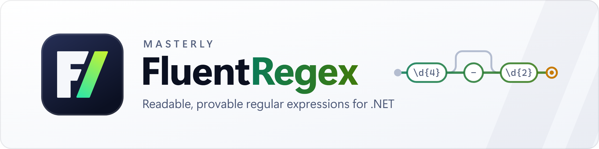

# Masterly.FluentRegex

A fluent, immutable API for building .NET regular expressions, plus the tools to understand, test,
secure and ship them.

**[Read the documentation](https://a7mdfre7at.github.io/Masterly.FluentRegex/)** · [Quick Start](https://a7mdfre7at.github.io/Masterly.FluentRegex/docs/quick-start) · [Examples](https://a7mdfre7at.github.io/Masterly.FluentRegex/docs/examples) · [API Reference](https://a7mdfre7at.github.io/Masterly.FluentRegex/docs/api-reference) · [Playground](https://a7mdfre7at.github.io/Masterly.FluentRegex/playground/)

## Quick Start

```csharp
using Masterly.FluentRegex;

Pattern pattern = Pattern.With
    .StartOfLine
    .Digit.Repeat.OneOrMore
    .Literal("-")
    .Word.Repeat.Times(3, 5)
    .EndOfLine;

bool isMatch = pattern.IsMatch("123-abc");   // true
string regex = pattern.ToString();           // ^\d+-\w{3,5}$
```

## New in 3.1

```csharp
// Prove two patterns differ, with the shortest string that shows it
Pattern.Compare(Pattern.FromRegex(@"\d{3}"), Pattern.FromRegex(@"[0-9]{3}"));
// Not equivalent (left is a proper superset of right). Shortest counterexample: "00٠"

// Optimize with proof
Pattern.FromRegex("cat|car|cab").Optimize().Optimized.ToString();   // "ca[trb]"

// String interpolation in reverse
LogLine line = Template.Of<LogLine>("{Date:yyyy-MM-dd} [{Level}] {User}: {Message}")
    .Parse("2026-11-02 [WARN] ahmad: disk at 91%");

// Learn from examples
Pattern.Learn(match: new[] { "INV-2024-0001", "INV-2025-0420" }, reject: new[] { "INV-24-1" });

// Regex coverage, property testing and a backtracking profiler
pattern.MeasureCoverage(testInputs);
PatternProperty.ForMatching(pattern, s => int.TryParse(s, out _)).ThrowIfFailed();
Console.WriteLine(Pattern.FromRegex(@"(a+)+$").Profile("aaaaaaaaaaaaaaaaaaaaaaaa!"));

// Rules a regex can't express, and PII redaction
CommonPatterns.CreditCard().Must(Validators.Luhn, "Luhn checksum");
Redactor.For(CommonPatterns.Email(), CommonPatterns.PhoneNumberE164()).Mask(text);

// One rule for .NET, the browser and OpenAPI
CommonPatterns.ZipCode().ToJavaScript();   // /^\p{Nd}{5}(?:-\p{Nd}{4})?(?=\n?$)/u

// ...and the database: exact regex dialects, or a LIKE proven exact
Pattern invoice = Pattern.FromRegex(@"^INV-[0-9]{4}-[0-9]{4}\z");
invoice.ToSqlCondition("\"Number\"", RegexFlavor.PostgreSql);   // "Number" ~ '\AINV-[0-9]{4}-[0-9]{4}\Z'
invoice.ToLike(LikeDialect.SqlServer).IsExact;                   // true

// Unicode scripts and diacritic-insensitive matching
Pattern.With.Literal("محمد").IgnoreDiacritics().IsMatch("مُحَمَّد");   // true
```

Also new: streaming matches over `Stream`/`TextReader`, `Highlight` for terminals and HTML,
`[MatchesPattern]` for DataAnnotations, and the companion packages
`Masterly.FluentRegex.EntityFrameworkCore` (patterns in LINQ run in the database, with proven index
hints and `CHECK` constraints), `Masterly.FluentRegex.AspNetCore` (route constraints),
`Masterly.FluentRegex.Xunit` (theory data) and `Masterly.FluentRegex.AI` (verified AI drafting).

## Highlights in 3.0

```csharp
// Typed extraction straight into records
record LogEntry(DateTime Timestamp, Level Level, string Message);
LogEntry entry = logPattern.Extract<LogEntry>("2024-05-17T10:30:00 ERROR Disk full");

// Legacy regex to readable fluent C#
string code = Pattern.FromRegex(@"^(?<user>[\w.]+)@(?<host>[\w-]+\.\w{2,})$").ToFluentCode();

// Verified test data: valid samples and near misses
string[] good = CommonPatterns.IPv4().GenerateMatching(20, seed: 42);
string[] bad  = CommonPatterns.IPv4().GenerateNonMatching(20, seed: 42);

// ReDoS analysis, proven with a timed attack input
SafetyReport report = Pattern.FromRegex(@"^(\w+\s?)*$").AnalyzeSafety(confirm: true);  // Risk: High, Confirmed

// See which part matched what, or exactly where matching failed
Console.WriteLine(datePattern.Trace("2024-5-17"));

// Railroad diagrams and Mermaid flowcharts
File.WriteAllText("email.svg", CommonPatterns.Email().ToRailroadSvg());

// Validated, fluent replacements
datePattern.Replace(text, r => r.Group("day").Literal("/").Group("month").Literal("/").Group("year"));
```

## Compile-Time Checks Included

The package ships a source generator, analyzers and a code fix. No extra install is needed.

- `[GeneratePattern]` evaluates a fluent chain at build time and emits the regex text and a cached, compiled `Regex`.
- Build diagnostics for invalid regexes (FRX003), ReDoS risks (FRX004, FRX005), builder calls that would throw (FRX006) and `Extract<T>` group typos (FRX008).
- A code fix adds a .NET `[GeneratedRegex]` method for any constant pattern (FRX007).

## Also New

- Immutable patterns: every call returns a new pattern, so building blocks are safe to share.
- `.Lazy`, `.Possessive`, `OneOf`, the `+` and `|` operators, `Range`, `HexDigit`, `AnyOf`, `NoneOf`, Unicode categories and inline options.
- `WithTimeout`, `UseNonBacktracking`, `Count`, span overloads, `EnumerateMatches` and `EnumerateSplits`.
- New common patterns: E.164 phones, IBAN, SemVer, JWT, MAC address, Base64, slugs, ISO 8601 date-times, Markdown links, and strictness levels for email and URL.
- Targets .NET 10, .NET 8 (trimming and Native AOT compatible) and .NET Standard 2.1.

## Command-Line Tool

```bash
dotnet tool install --global Masterly.FluentRegex.Tool
fluentregex scan src --fail-on high     # find ReDoS-prone regexes in any C# codebase
fluentregex compare '\d+' '[0-9]+'      # prove equivalence or show a counterexample
fluentregex export '^\d{5}$' --to js    # translate for JavaScript or JSON Schema
```

## Upgrading from 2.x

Patterns are now immutable, and several 2.x bugs are fixed, including `Literal` ranges inside sets,
`Letter` outside sets and `AtMost`. See
[Upgrading from 2.x](https://a7mdfre7at.github.io/Masterly.FluentRegex/docs/upgrading-from-2x).

## Documentation

Full documentation, examples and API reference:
[a7mdfre7at.github.io/Masterly.FluentRegex](https://a7mdfre7at.github.io/Masterly.FluentRegex/).

## License

MIT
