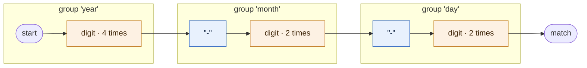
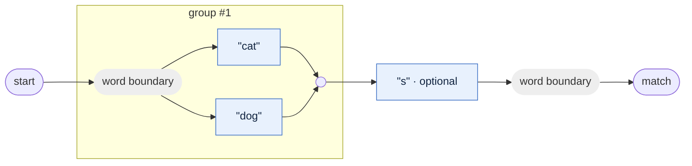
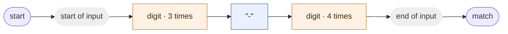

A diagram shows the shape of a pattern at a glance: which parts are fixed text, which are character classes, where the branches split and join, and what repeats. Masterly.FluentRegex draws any pattern in two formats. A railroad diagram is an SVG image you save next to your docs. A Mermaid flowchart is plain text that GitHub, GitLab and many documentation tools turn into a diagram for you.

Use diagrams when you need to:

- explain a non-trivial pattern in a README, a wiki page or an architecture document,
- show reviewers what a regex change does in a pull request,
- check by eye that a pattern built in code has the structure you meant,
- keep the pictures in your docs in sync with the patterns in your code.

| Method | Returns | Best for |
|--------|---------|----------|
| `ToRailroadSvg()` | A complete SVG document as a `string`. | Docs sites, READMEs, HTML reports. Anywhere an image works. |
| `ToMermaid()` | Mermaid flowchart source as a `string`. | Pull request descriptions, issues, comments and Markdown files that render Mermaid. |

Both methods are on `Pattern`, in the `Masterly.FluentRegex` namespace. They take no parameters and have no options, and they work on every target the package supports: .NET Standard 2.1, .NET 8 and .NET 10.

## Drawing a pattern

Call either method on any pattern, whether you built it with the fluent API, took it from `CommonPatterns` or wrapped an existing regex with `Pattern.FromRegex`.

```csharp
using System;
using System.IO;
using Masterly.FluentRegex;

Pattern email = CommonPatterns.Email();

File.WriteAllText("email.svg", email.ToRailroadSvg()); // railroad diagram
File.WriteAllText("email.mmd", email.ToMermaid());     // Mermaid flowchart source
```

This is the railroad diagram that `CommonPatterns.Email()` produces:


- Both methods read the pattern's regex text, so the diagram always shows what the engine will run, including text added with `RegEx(...)`.
- The pattern's `RegexOptions` are taken into account. With `RegexOptions.Multiline`, `^` is drawn as "start of line" instead of "start of input". See [Options change the labels](#options-change-the-labels).
- The output is deterministic. The same pattern always gives the same text, so generated diagrams diff cleanly in source control.
- Neither method writes a file. You decide where the text goes.

## Railroad diagrams

`ToRailroadSvg()` returns a self-contained SVG document. It has no external fonts, scripts or style sheets, so you can save it as a `.svg` file, embed it in HTML or link to it from Markdown.

Read the diagram from left to right. Start at the dot on the left and follow any track to the dot on the right. Every path you can take spells out text the pattern matches.

```csharp
using System;
using Masterly.FluentRegex;

Pattern isoDate = Pattern.With
    .NamedGroup("year", Pattern.With.Digit.Repeat.Times(4)).Literal("-")
    .NamedGroup("month", Pattern.With.Digit.Repeat.Times(2)).Literal("-")
    .NamedGroup("day", Pattern.With.Digit.Repeat.Times(2));

string svg = isoDate.ToRailroadSvg();

Console.WriteLine(svg.Substring(0, svg.IndexOf('>') + 1));
// prints: <svg xmlns="http://www.w3.org/2000/svg" width="515.9" height="144" viewBox="0 0 515.9 144">
```

- The root `<svg>` element has a `width` and `height` in pixels and a matching `viewBox`, so the image scales cleanly when you resize it with CSS or an `` width.
- The first child is a `<title>` that holds the full regex text, XML-escaped. Browsers show it as a tooltip, and screen readers can read it.
- An embedded `<style>` block sets the colors and fonts. See [Styling the SVG](#styling-the-svg).

A larger example, `CommonPatterns.SemVer()`, with named groups, alternatives, optional parts and loops:


### How each construct is drawn

| Regex construct | Drawn as | Example text in the box |
|-----------------|----------|-------------------------|
| Literal text | Blue box with rounded corners. Adjacent literal characters are merged into one box. | `"cat"`, `"-"` |
| Character class, shorthand, Unicode category | Orange box. | `digit`, `word char`, `any char`, `whitespace`, `one of [A-Z]`, `none of [a-z 0-9 _]`, `uppercase letter`, `not letter`, `block Greek`, `one of [a-z] minus [a e i o u]` |
| Backreference | Orange box. | `same as #1`, `same as 'o'` |
| Anchor | Gray box. | `start of input`, `end of input`, `start of line`, `end of line`, `word boundary`, `not a word boundary`, `where the previous match ended` (`\G`), `end of input (or before a final newline)` (`\Z`) |
| Inline options, such as `(?i)` | Gray box with the options text. | `(?i)`, `(?m)` |
| Conditional, such as `(?(name)yes\|no)` | Gray box with the conditional's regex text. | `(?(o)a\|b)` |
| Capturing group | Dashed box around its content, with a label. | `group #1` |
| Named group | Dashed box with a label. | `group 'year'` |
| Non-capturing group `(?:...)` | No box. Only its content is drawn. | |
| Lookahead, lookbehind, atomic, options and balancing groups | Dashed box with a label. | `followed by`, `not followed by`, `preceded by`, `not preceded by`, `atomic group (no backtracking)`, `group with options i`, `balancing group 'b' popping 'a'` |
| Alternation `a\|b` | Branches stacked on top of each other, splitting and joining with curves. | |
| Optional `?` | A bypass track above the item. | |
| Repetition | A loop track below the item that returns to its start. A label under the loop gives the count when it is not plain `+` or `*`. | `3 times` |
| Comments `(?#...)` and `{0}` | Not drawn. | |

Characters that are hard to see are made visible inside the boxes: a space is shown as `␣`, a tab as `\t`, a newline as `\n`, a carriage return as `\r` and any other control character as `\uXXXX`.

### Loop labels

A loop without a label means "one or more". The label tells you anything else you need to know about the count:

| Quantifier | Railroad drawing | Loop label |
|------------|------------------|------------|
| `?`, `{0,1}` | Bypass | None |
| `??` | Bypass | None. The lazy marker is not shown. |
| `+`, `{1,}` | Loop | None |
| `*`, `{0,}` | Bypass and loop | None |
| `+?`, `*?` | Loop (and bypass for `*?`) | `lazy` |
| `{3}` | Loop | `3 times` |
| `{3}?` | Loop | `3 times, lazy` |
| `{2,4}` | Loop | `2-4 times` |
| `{0,3}` | Bypass and loop | `0-3 times` |
| `{2,}` | Loop | `at least 2` |
| `{2,}?` | Loop | `at least 2, lazy` |
| `{1}`, `{1}?` | Drawn once, no loop | None |
| `{0}` | Nothing | None |

A quantified anchor or conditional, such as `\b?`, is drawn the same way: its gray box gets a bypass or a loop.

### Reading the SVG in code

The output is well-formed XML (with one exception, in the warning below), so you can load it with `XDocument` to check it in a test or post-process it. Labels under loops and on group boxes have `class="label"`. The text inside a box sits in a `<g>` whose `class` is `literal`, `charclass` or `anchor`.

```csharp
using System;
using System.Xml.Linq;
using Masterly.FluentRegex;

Pattern sku = Pattern.With
    .StartOfLine
    .UppercaseLetter.Repeat.Times(2, 4)
    .Literal("-")
    .Digit.Repeat.OneOrMore
    .NonCapturingGroup(Pattern.With.Literal("-").LowercaseLetter.Repeat.Times(2)).Repeat.Optional
    .EndOfLine;

XNamespace svgNamespace = "http://www.w3.org/2000/svg";
XDocument document = XDocument.Parse(sku.ToRailroadSvg());

foreach (XElement text in document.Descendants(svgNamespace + "text"))
{
    // Parent is never null here: every <text> sits inside the <svg> root or a <g>.
    string kind = (string?)text.Attribute("class") ?? (string?)text.Parent!.Attribute("class") ?? string.Empty;
    Console.WriteLine($"{kind}: {text.Value}");
}
```

Output:

```text
anchor: start of input
charclass: one of [A-Z]
label: 2-4 times
literal: "-"
charclass: digit
literal: "-"
charclass: one of [a-z]
label: 2 times
anchor: end of input
```

- The regex for this pattern is `^[A-Z]{2,4}-\d+(?:-[a-z]{2})?$`.
- `\d+` has no label because a plain loop already means "one or more".
- The optional non-capturing group has no box and no label. It is drawn as a bypass above `"-"` and `one of [a-z]`.
- `StartOfLine` and `EndOfLine` write `^` and `$`. Without `RegexOptions.Multiline` they mean the start and end of the input, so that is what the boxes say.

:::warning

The SVG is well-formed XML for any regex text that does not contain raw control characters. When the regex text itself holds a raw control character other than tab, line feed or carriage return, for example `Pattern.FromRegex("a\u0001")` with a C# escape, the `<title>` gets a character reference such as `&#x1;`. XML 1.0 does not allow that reference, so `XDocument.Parse` throws an `XmlException`. Write the regex escape instead (`@"a\x01"` or `@"a\u0001"`). `Literal(...)` already writes control characters as regex escapes.

:::

### Styling the SVG

The embedded `<style>` block uses these CSS classes. Change them by post-processing the string, or override them from a page style sheet when you place the SVG inline.

| CSS class | Element | Default look |
|-----------|---------|--------------|
| `track` | Every line and curve. | Gray (`#4b5563`) stroke, 2 px. |
| `literal` | Group around a literal box. | Light blue fill, blue border. |
| `charclass` | Group around a character class or backreference box. | Light orange fill, orange border. |
| `anchor` | Group around an anchor, inline options or conditional box. | Light gray fill, gray border. |
| `group` | Group around a dashed group box. | No fill, dashed gray border. |
| `label` | Loop and group labels. | 11 px gray text. |
| `marker` | The start and end dots. | Gray fill. |

All text uses a 12 px monospace font (`ui-monospace, SFMono-Regular, Menlo, Consolas, monospace`) in dark gray (`#1f2937`). This comes from a rule on the plain `text` element, not from a class.

:::warning

When you paste the SVG markup directly into an HTML page, its `<style>` rules apply to the whole page, not just the diagram. A page that uses the class names `track`, `literal`, `charclass`, `anchor`, `group`, `label` or `marker` can be restyled by the diagram, and the other way round. The plain `text` rule also changes the font of every SVG `<text>` element on the page, such as the labels of an inline chart. Use an `` tag or a data URI (see [In HTML](#in-html)) to keep the styles apart.

:::

### Size and long text

- The width grows with the text in the boxes, about 7.4 px per character. `CommonPatterns.SemVer()` is 3426.6 px wide and 298 px high.
- A box shows at most 48 characters. Longer text is cut to 45 characters followed by `...`. For a literal of 60 `x` characters, the box shows a quote, 44 `x` characters and `...`. The full regex is still in the `<title>`.
- An empty pattern gives an 80 by 40 px diagram with just the two dots and a short track between them.
- The SVG text ends with a line break.

:::tip

A very wide diagram is hard to read. Draw the important sub-patterns on their own instead. For example, draw the `prerelease` part of a version pattern separately and describe how it fits into the whole in your text. See [Composing patterns](./composing-patterns.md) for building patterns from named parts.

:::

## Mermaid flowcharts

`ToMermaid()` returns the source of a Mermaid flowchart. Many Markdown renderers draw it when you put it in a code block whose language is `mermaid`. It is text, so it fits where an image upload does not, such as a pull request description or a comment, and it diffs line by line.

```csharp
using System;
using Masterly.FluentRegex;

Pattern isoDate = Pattern.With
    .NamedGroup("year", Pattern.With.Digit.Repeat.Times(4)).Literal("-")
    .NamedGroup("month", Pattern.With.Digit.Repeat.Times(2)).Literal("-")
    .NamedGroup("day", Pattern.With.Digit.Repeat.Times(2));

Console.WriteLine(isoDate.ToMermaid());
```

Output:



- The chart always starts with `flowchart LR` (left to right), a rounded `start` node and ends with a rounded `match` node.
- Node IDs start with `n` for items, `g` for group subgraphs and `j` for alternation joins. All three share one counter, so the numbers skip: here the IDs are `g0`, `n1`, `n2`, `g3` and so on. The same pattern always produces the same IDs.
- Labels use the same words as the railroad diagram. A count is added after a middle dot: `digit · 4 times`.
- The three `classDef` lines are always present. A `class` line is added only for a style that some node uses.
- The output has no trailing newline.

### How each construct is shown

| Regex construct | Mermaid shape | Example label |
|-----------------|---------------|---------------|
| Literal text | Rectangle, `literal` style. Adjacent literal characters are merged. | `"cat"` |
| Character class, backreference | Rectangle, `charclass` style. | `digit`, `one of [a-z]`, `same as 'o'` |
| Anchor, inline options | Rounded (stadium) node, `anchor` style. | `start of input`, `word boundary`, `(?i)` |
| Conditional | Rectangle, `anchor` style, with the conditional's regex text. | `(?(o)a\|b)` |
| Capturing, named and special groups | A titled `subgraph` around the group's content. | `group #1`, `group 'year'`, `followed by`, `atomic group (no backtracking)` |
| Non-capturing group without a quantifier | Not shown. Its content is drawn inline. | |
| Alternation | Each branch starts from the same node, and all branches meet at a small empty circle. | |
| Quantified literal, class or backreference | One node, with the count in its label. | `"s" · optional` |
| Quantified anchor or conditional | Rectangle, `anchor` style. The label is the item's regex text, not its description, followed by the count. | `\b · optional` |
| Quantified group | The count is added to the subgraph title. A quantified non-capturing group gets a subgraph titled with just the count. | `group #1 · 1+ times`, `1+ times` |
| Comments `(?#...)` | Not drawn. | |

Here is an alternation inside a capturing group:

```csharp
Pattern pet = Pattern.FromRegex(@"\b(cat|dog)s?\b");

Console.WriteLine(pet.ToMermaid());
```

Output:



### Count labels

Mermaid labels describe counts a little differently from railroad loop labels, because there is no loop to draw:

| Quantifier | Mermaid count |
|------------|---------------|
| `?`, `{0,1}` | `optional` |
| `??` | `optional, lazy` |
| `+`, `{1,}` | `1+ times` |
| `*`, `{0,}` | `0+ times` |
| `+?`, `*?` | `1+ times, lazy`, `0+ times, lazy` |
| `{3}` | `3 times` |
| `{2,4}` | `2-4 times` |
| `{0,3}` | `0-3 times` |
| `{2,}` | `2+ times` |
| `{2,}?` | `2+ times, lazy` |
| `{1}`, `{1}?` | `1 times`, `1 times, lazy` |
| `{0}` | `0 times`. Unlike the railroad diagram, the item is still drawn. |

:::note

A Mermaid flowchart has a single path through it. Optional parts and repetitions appear only as words in a label or a subgraph title, not as extra arrows. When you need the reader to see the bypass and loop tracks, use the railroad diagram.

:::

### Escaping

Mermaid would misread some characters inside a quoted label, so the renderer writes them as Mermaid entity codes. These four are the only characters it escapes. Everything else, including `&`, `[`, `]` and `|`, is written as it is.

| Character | Written as |
|-----------|------------|
| `"` | `#quot;` |
| `#` | `#35;` |
| `<` | `#lt;` |
| `>` | `#gt;` |

That is why you see `#quot;-#quot;` and `group #35;1` in the source. Mermaid shows them as `"-"` and `group #1`. The railroad diagram uses XML escaping instead: `"`, `<`, `>` and `&` become `&quot;`, `&lt;`, `&gt;` and `&amp;`, and `#` is left as it is.

## Options change the labels

Both renderers parse the regex with the pattern's own `RegexOptions`. The options change what some items mean, so they change the labels too.

```csharp
using System;
using System.Text.RegularExpressions;
using Masterly.FluentRegex;

Pattern line = Pattern.FromRegex(@"^\w+$");
Pattern multiline = Pattern.FromRegex(@"^\w+$", RegexOptions.Multiline);
Pattern verbose = Pattern.FromRegex(@"\d{3} - \d{4}   # local number", RegexOptions.IgnorePatternWhitespace);

Console.WriteLine(line.ToMermaid().Split('\n')[2].Trim());      // n0(["start of input"])
Console.WriteLine(multiline.ToMermaid().Split('\n')[2].Trim()); // n0(["start of line"])
Console.WriteLine(verbose.ToMermaid().Split('\n')[4].Trim());   // n1["#quot;-#quot;"]
```

- With `RegexOptions.Multiline`, `^` and `$` are drawn as `start of line` and `end of line`.
- With `RegexOptions.IgnorePatternWhitespace`, unescaped spaces and `#` comments are left out, just as the engine ignores them. The `-` becomes one literal box.
- Options set with `WithOptions(...)` work the same way as options passed to `FromRegex`.
- Inline options inside the regex, such as `(?m)`, are drawn as their own item and also change the labels of the items after them. `a(?m)^b` shows `"a"`, `(?m)`, `start of line` and `"b"`.
- Methods that rewrite the regex text change the diagram too. After `WithAsciiDigits()`, `\d` is drawn as `one of [0-9]` instead of `digit`.

## Embedding diagrams in docs and pull requests

### In Markdown and on docs sites

Save the SVG next to your Markdown and link to it as an image. GitHub, GitLab and most static site generators show SVG files in Markdown.

```markdown

```

- Always write alt text. The diagram is a picture, so readers who cannot see it rely on the alt text and the surrounding prose.
- Commit the generated `.svg` file. It is text, so a pattern change shows up as a readable diff in review.

### In pull requests, issues and comments

Where you cannot upload a file, paste the Mermaid source into a fenced code block with the `mermaid` language. GitHub renders such blocks in pull request descriptions, issues, comments and Markdown files.

```csharp
using System;
using System.IO;
using Masterly.FluentRegex;

Pattern phone = Pattern.FromRegex(@"^\d{3}-\d{4}$");

string markdown = string.Join(Environment.NewLine,
    "## Phone number format",
    string.Empty,
    "```mermaid",
    phone.ToMermaid(),
    "```");

File.WriteAllText("phone.md", markdown);
```

The file `phone.md` contains:

````markdown
## Phone number format


````

:::note

Not every tool uses the fenced-block syntax. Azure DevOps wiki pages, for example, wrap Mermaid source in `::: mermaid` and `:::` lines, and Docusaurus needs the `@docusaurus/theme-mermaid` theme before it draws `mermaid` blocks. Check how your platform expects Mermaid before you automate it.

:::

### In HTML

An `` tag that points to the `.svg` file is the simplest option. For a single-file HTML report, put the SVG in a data URI instead:

```csharp
using System;
using System.Text;
using Masterly.FluentRegex;

Pattern phone = Pattern.FromRegex(@"^\d{3}-\d{4}$");
byte[] svgBytes = Encoding.UTF8.GetBytes(phone.ToRailroadSvg());

string dataUri = $"data:image/svg+xml;base64,{Convert.ToBase64String(svgBytes)}";
string html = $"";

Console.WriteLine(html.Substring(0, 70)); // prints: ` keeps its styles to itself, so it cannot clash with the page's CSS.
- You can also paste the markup inline. All pattern text is escaped, so the markup is safe to inline even for patterns that came from users. Keep the [styling warning](#styling-the-svg) in mind.

### From the command line

The `fluentregex` tool draws diagrams without writing any code. It is handy in scripts and CI jobs.

```bash
fluentregex diagram '^\d{3}-\d{4}$' --output phone.svg
fluentregex diagram '^\d{3}-\d{4}$' --format mermaid
fluentregex diagram '^\w+$' --format mermaid --options Multiline
```

| Option | Values | Default |
|--------|--------|---------|
| `--format` | `svg` or `mermaid` (not case-sensitive). | `svg` |
| `--output` | A file path. The tool writes the diagram there and prints `Wrote <file>` to standard error. | Print the diagram to standard output. |
| `--options` | Comma-separated `RegexOptions` names, not case-sensitive, such as `IgnoreCase,Multiline`. | None |
| `--ascii-digits` | A switch. Applies `WithAsciiDigits()` first, so `\d` is drawn as `one of [0-9]`. | Off |

An unknown format, an unknown option name or an invalid regex prints an `error:` line to standard error, such as `error: Unknown --format 'png'. Use svg or mermaid.`, and exits with code 2. See [Command-line tool](./command-line-tool.md) for installation and the other commands.

The [Playground](./playground.md) has a Diagram tab. It shows the railroad diagram for whatever pattern you type, with the Mermaid source in a collapsible "Mermaid source" section below it.

## Keeping diagrams in sync

A diagram in your docs goes stale as soon as someone changes the pattern. Generate the files from code instead of drawing them by hand, and let a test fail when a committed diagram no longer matches.

Generate the files from a small console app or a build step:

```csharp
using System.Collections.Generic;
using System.IO;
using Masterly.FluentRegex;

Dictionary<string, Pattern> documented = new Dictionary<string, Pattern>
{
    ["email"] = CommonPatterns.Email(),
    ["semver"] = CommonPatterns.SemVer(),
    ["ipv4"] = CommonPatterns.IPv4(),
};

string outputDirectory = Path.Combine("docs", "diagrams");
Directory.CreateDirectory(outputDirectory);

foreach (KeyValuePair<string, Pattern> entry in documented)
{
    File.WriteAllText(Path.Combine(outputDirectory, $"{entry.Key}.svg"), entry.Value.ToRailroadSvg());
    File.WriteAllText(Path.Combine(outputDirectory, $"{entry.Key}.mmd"), entry.Value.ToMermaid());
}

// docs/diagrams now holds email.mmd, email.svg, ipv4.mmd, ipv4.svg, semver.mmd, semver.svg
```

Then compare the committed file with a fresh render in a test:

```csharp
using System;
using System.IO;
using Masterly.FluentRegex;
using Xunit;

public class DiagramTests
{
    [Fact]
    public void EmailDiagram_MatchesCommittedFile()
    {
        string committed = File.ReadAllText(Path.Combine(AppContext.BaseDirectory, "diagrams", "email.svg"));
        string current = CommonPatterns.Email().ToRailroadSvg();

        Assert.Equal(committed, current, ignoreLineEndingDifferences: true);
    }
}
```

- Copy the committed diagrams to the test output folder, for example with `<None Include="diagrams\**" CopyToOutputDirectory="PreserveNewest" />` in the test project.
- Ignore line-ending differences. Both renderers end lines with `Environment.NewLine`, so the text has `\r\n` on Windows and `\n` on Linux and macOS. Git may also convert line endings on checkout.
- Numbers in the SVG are always written with the invariant culture, so the output does not change with the machine's language settings.

## Errors

Both methods parse the pattern's regex text. When the text is not valid .NET regex syntax, they throw `InvalidOperationException`. This can only happen when invalid text got in through `RegEx(...)`, because `Pattern.FromRegex` validates its input and throws `ArgumentException` straight away.

```csharp
using System;
using Masterly.FluentRegex;

// regex comes from configuration, so the compiler cannot check it
string regex = Environment.GetEnvironmentVariable("NOT_SET") ?? "(unclosed";

Pattern raw = Pattern.With.RegEx(regex);

try
{
    raw.ToRailroadSvg();
}
catch (InvalidOperationException ex)
{
    Console.WriteLine(ex.Message); // prints: The pattern is not valid regex syntax: Not enough )'s (at position 0)
}

try
{
    Pattern.FromRegex(regex);
}
catch (ArgumentException ex)
{
    Console.WriteLine(ex.Message);
    // prints: The regular expression is invalid: Invalid pattern '(unclosed' at offset 9. Not enough )'s. (Parameter 'regex')
}
```

- `ToMermaid()` throws the same `InvalidOperationException` with the same message.
- The inner exception holds the parser's error.
- When the invalid regex is a constant in your code, the analyzer reports it at compile time (`FRX003` for `RegEx("(")`, `FRX006` for `Pattern.FromRegex("(")`), so the build fails before the code runs. See [Compile-time checks](./compile-time-checks.md).

## Performance and thread safety

- Each call parses the regex text and builds a new string. Nothing is cached. For typical patterns this takes a fraction of a millisecond. In a Release build on a desktop machine, the email pattern rendered as SVG in a few hundredths of a millisecond, and the much larger SemVer pattern in about a tenth of a millisecond. Timings vary by machine. It is still work you do not need to repeat per request.
- In a web app that shows diagrams, render each pattern once and cache the string, or generate the files at build time.
- `Pattern` is immutable, and both renderers use only state local to the call. You can call `ToRailroadSvg()` and `ToMermaid()` on the same pattern from many threads at once.

## Common pitfalls

- **Expecting options on `ToRailroadSvg()`.** There are none. To change colors or fonts, post-process the SVG string or override the CSS classes from [Styling the SVG](#styling-the-svg).
- **Reading lazy `??` from the railroad diagram.** The railroad diagram draws `a??` exactly like `a?`. The Mermaid label says `optional, lazy`.
- **Looking for loops in the Mermaid chart.** Mermaid shows counts as text only. Use the railroad diagram when the shape of repetitions matters.
- **Diagramming a huge pattern in one picture.** Very wide SVGs are hard to read in a docs page. Draw the meaningful parts separately.
- **Pasting SVG markup inline into a styled page.** The embedded `<style>` rules leak into the page. Prefer `` or a data URI.
- **Comparing generated files byte for byte across operating systems.** Line endings follow `Environment.NewLine`. Normalize them first.
- **Raw control characters in the regex text.** Any except tab, line feed and carriage return make the SVG invalid XML. Use regex escapes such as `\x01` instead.

## Related pages

- [Validation and debugging](./validation-and-debugging.md): explain a pattern in plain English and find problems in it.
- [Match tracing](./match-tracing.md): see which part of a pattern matched which part of an input.
- [Highlighting](./highlighting.md): color the matches inside text for the console or HTML.
- [Regex to fluent code](./regex-to-fluent-code.md): turn a diagrammed regex into fluent C#.
